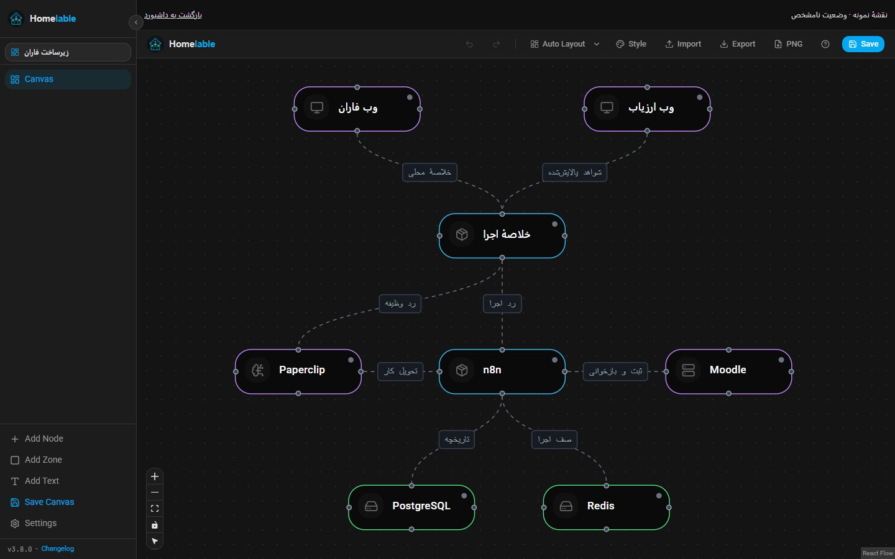
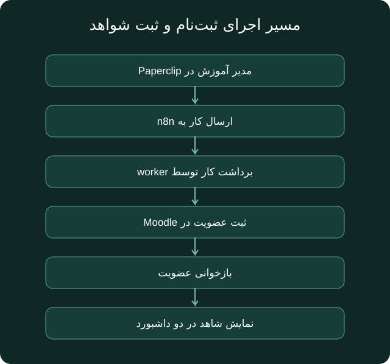
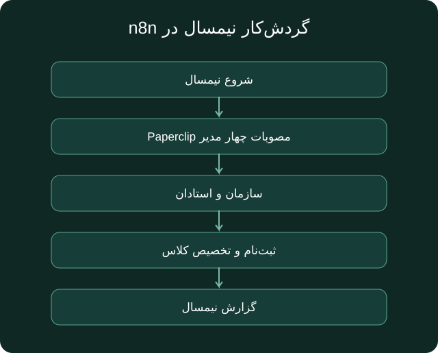

# دانشگاه ایجنتیک فاران: طرحی برای سازمان آموزشی چندعاملی

**نوع سند:** مقالهٔ فنی و گزارش ارزیابی مبتنی بر شواهد، بازبینی ۲۵ نوامبر ۲۰۲۶
**درس:** سمینار
**استاد:** دکتر سعید شکراللهی
**دانشجو:** محمد مهرانی

## چکیده

فارانی که در این مقاله بررسی می‌شود یک نمونهٔ دانشگاه دیجیتال برای درس سمینار است. ساختار سازمانی آن از چارت منتشرشدهٔ مؤسسه بازخوانی شده و رفتار ثبت‌نام در یک محیط محلی با پرونده‌های ساختگی سنجیده شده است. Paperclip واگذاری کار را ثبت می‌کند، n8n مسیر اجرا را نگه می‌دارد و بازخوانی Moodle مشخص می‌کند که دانشجو در گروه مورد انتظار قرار گرفته است. در داده‌های بایگانی‌شده، عضویت ۱۰۰ پرونده با برنامهٔ نیمسال تطبیق داشت. در رقابت دو درخواست برای یک صندلی، یک انتقال انجام شد و دانشجوی دیگر عضویت قبلی‌اش را حفظ کرد.

## مبنای سازمانی

چارت رسمی نقطهٔ شروع تشخیص نقش‌ها و رابطه‌های دانشگاه است. بوم Homelable شامل ۳۰ عنوان و ۲۹ پیوند ترسیم‌شده است و از آن به شاخه‌های آموزش، گروه‌های آموزشی، امور اداری‌مالی، مدیریت فنی، پژوهش و امور دانشجویی می‌توان رسید. گردش داخلی و اختیار تصویب هر واحد در حد سند موجود توصیف شده است. برای نمونه، پرسش‌های رسمی ارشد تنظیم ترم‌بندی را به مدیر گروه هر رشته و تصمیم حذف نیمسال را به شورای آموزشی نسبت می‌دهد. [چارت رسمی فاران](https://faran.ac.ir/faran-chart/) · [پرسش‌های کارشناسی ارشد](https://faran.ac.ir/?page_id=3489)

## معماری و روش مشاهده

نمای عمومی پروژه شامل چارت تعاملی، منابع دانشگاه، سناریوهای نیمسال و صفحهٔ گزارش است. ثبت‌نام آزمایشی در مسیر محلی Paperclip، n8n و Moodle انجام شد. برای تشخیص محل تأخیر، زمان ورود، شروع، پایان و انتقال بین مراحل به همان درخواست نسبت داده شد. PostgreSQL تاریخچهٔ اجرای n8n و Redis صف worker را ثبت کردند. در تحلیل، رسید Moodle ملاک سازگاری عضویت بود و وضعیت پایان اجرای گردش‌کار به‌عنوان شاهد جداگانه ثبت شد.

## نتیجه و دامنهٔ اعتبار

۲٬۰۰۰ شناسهٔ نقش در دفتر بایگانی و کاتالوگ عمومی تطبیق داده شدند. این شمارش پوشش شواهد همان آزمایش را گزارش می‌کند. نتیجه دربارهٔ یادگیری دانشجو، صلاحیت مدرس، خودمختاری نقش یا ظرفیت هم‌زمان دانشگاه به اندازه‌گیری جداگانه نیاز دارد. صفحات عمومی برای مشاهده و بازبینی شواهد در دسترس‌اند و تصاویر کنسول‌های محلی به اجرای ثبت‌شده در زمان آزمایش تعلق دارند. [فایل شواهد](https://faran-mu.vercel.app/docs/seminar-results.json)

## نقشهٔ تعاملی زیرساخت

برای نمایش وابستگی سرویس‌های دانشگاه، از ویرایشگر مستقل Homelable استفاده شد. این نما، مسیر میان وب فاران، Paperclip، n8n، Moodle، PostgreSQL و Redis را با دادهٔ نمونه نشان می‌دهد. ارزیابیِ زمان صف و نتیجهٔ ثبت‌نام بر شواهد اجرای همان درخواست تکیه دارد.

<!-- figure destinations -->[باز کردن نقشهٔ تعاملی زیرساخت](https://faran-mu.vercel.app/topology/index.html?design=faran-infrastructure)

## منابع

- Pouzor. (2026). *Homelable v3.8.0* [نرم‌افزار، مجوز MIT]. https://github.com/Pouzor/homelable/tree/v3.8.0

1. EDUCAUSE. *The Higher Education Reference Models*. 2021. https://library.educause.edu/resources/2021/9/the-higher-education-reference-models (صفحهٔ معرفی بررسی شد؛ بستهٔ کامل مدل‌ها دریافت نشده است.)
2. AAUP. *Statement on Government of Colleges and Universities*. https://www.aaup.org/reports-publications/aaup-policies-reports/topical-reports/statement-government-colleges-and
3. UNESCO Institute for Statistics. *ISCED Fields of Education and Training 2013: Detailed field descriptions*. https://www.uis.unesco.org/sites/default/files/medias/fichiers/2025/04/international-standard-classification-of-education-fields-of-education-and-training-2013-detailed-field-descriptions-2015-en.pdf

---

## آزمون مقدماتی واگذاری به چهار نقش

در ۲۳ نوامبر ۲۰۲۶ ابتدا تاریخچهٔ خالی دانشگاه ثبت شد. سپس برای چهار نقش، چهار مأموریت محلی تعریف شد. مدیریت دانشگاه طرح پروژه را خواند، آموزش فهرست درس نمونه را بررسی کرد، مهندسی کامپیوتر مقالهٔ سمینار را خواند و فناوری اطلاعات پیکربندی سرویس‌ها را بررسی کرد. هر برنامه پس از خواندن فایل، تعداد خطوط غیرخالی را گزارش داد. خطای خواندن یا خالی بودن فایل باعث شکست برنامه می‌شد.

| نقش | موضوع بررسی | نتیجهٔ ثبت‌شده |
|---|---|---|
| مدیریت دانشگاه | طرح پروژه | موفق |
| مدیریت آموزش | درس سمینار | موفق |
| مهندسی کامپیوتر | مقالهٔ سمینار | موفق |
| فناوری اطلاعات | پیکربندی محلی | موفق |

در این مشاهده، دانشگاه توانست چهار مسئولیت را به چهار اجراکننده بسپارد و برای هر اجرا سابقه‌ای جدا نگه دارد. درس سمینار نیز در Moodle ایجاد شده بود. این دو مشاهده به دو مسیر جدا تعلق دارند. هنوز از تغییر یک تکلیف در Moodle، اجرای خودکار عامل و بازگشت نتیجه به همان تکلیف شواهدی ثبت نشده است.

این بررسی با دادهٔ آزمایشی و برنامهٔ قطعی انجام شد. برای سنجش کیفیت آموزشی باید خروجی هر مأموریت با معیار از پیش تعیین‌شده و داوری مستقل مقایسه شود.

## بازتولید آزمون از راه‌اندازی Docker

برای درس سمینار، معیار آزمون این بود که برنامهٔ مدیر آموزش از گردش‌کار عبور کند و عضویت فعال دانشجوی آزمایشی در درس سمینار در Moodle تأیید شود.

Docker Desktop را راه‌اندازی کنید و با docker ps بالا بودن پایگاه داده، Moodle، Redis و worker را بررسی کنید. پس از آماده شدن n8n، گردش‌کار محلی ثبت‌نام را فراخوانی کنید. شناسهٔ اجرای n8n و شناسهٔ برنامهٔ مدیر را بردارید. سپس عضویت آزمایشی را از Moodle بازخوانی کنید. در اجرای ثبت‌شده، n8n شمارهٔ ۲۰۱۲ و Moodle درس شمارهٔ ۴ را گزارش کردند. مرحلهٔ بازخوانی با ابزار محلی انجام شد.

<!-- figure destinations -->[رسید بایگانی‌شدهٔ اجرای ثبت‌نام](https://faran-mu.vercel.app/docs/execution-evidence.json)

## ضمیمهٔ فنی زبان‌ها و الگوریتم‌ها

### HTML و CSS

HTML ساختار معنایی صفحه، فرم، جدول و مقاله را تعریف می‌کند. CSS جهت راست‌به‌چپ، چیدمان واکنش‌گرا، رنگ و وضعیت تمرکز را تنظیم می‌کند. این دو بخش رابط‌اند.

### JavaScript و Node.js

JavaScript منو، رویدادهای فرم و کنترل‌های داشبورد را اجرا می‌کند. فایل‌های .mjs ماژول‌های JavaScript هستند. فایل sw.js کش رابط مرورگر را مدیریت می‌کند. نشست نمایشی با sessionStorage نگه‌داری می‌شود.

### Java، Gradle و Capacitor

MainActivity.java نقطهٔ ورود بستهٔ اندروید است. Gradle فرایند ساخت را تنظیم می‌کند و Capacitor دارایی‌های وب را در پوستهٔ اندروید نمایش می‌دهد. منطق آموزشی یا آماری به Java منتقل نشده است.

### قالب‌ها و ابزار اجرا

JSON قالب تبادل رویداد و تعریف گردش‌کار است. YAML تنظیمات Compose یا GitHub Actions را نگه می‌دارد. SQL برای پرس‌وجو و نگه‌داری داده به‌کار می‌رود. تصویر به‌تنهایی جایگزین سند JSON نیست.

### Python و PowerShell

Python در faran.py نقش‌ها و اجرای نمونه را مدیریت می‌کند. اسکریپت‌های Python شواهد آزمون را گردآوری می‌کنند. PowerShell برای راه‌اندازی محلی، واردکردن گردش‌کار و پشتیبان‌گیری است.

### PHP و Moodle

trace-enrol.php از API داخلی Moodle برای ثبت‌نام و بازخوانی عضویت فعال استفاده می‌کند. مسیر آزمایشی رقابت ظرفیت در race-seat.php بررسی و انتقال را با قفل ردیف گروه مقصد در یک تراکنش انجام می‌دهد.

### ساخت نقش و شناسهٔ پایدار

نقش‌ها با شناسهٔ role-0001 تا role-2000 در نگاشت قرار می‌گیرند. تولید و ادغام متوسط O(R)، و مرتب‌سازی خروجی O(R log R) است. اجرای نمونه با شناسهٔ تسک موجود، نتیجهٔ ذخیره‌شده را برمی‌گرداند. تعداد نقش تعریف‌شده شاخص تعداد اجرا نیست.

### صف ظرفیت و اعتبارسنجی عضویت

در سناریوی نیمسال، پس از آزاد شدن صندلی اولین نفر صف انتخاب می‌شود. deque درج و برداشت را با هزینهٔ سرشکن O(1) انجام می‌دهد. رخدادهای زمان‌دار در صف اولویت قرار می‌گیرند و عملیات آن O(log E) است. در آزمون عملیاتی، شاهد نهایی عضویت فعال در Moodle است.

### مرز اعتبار نتیجه

اجرای n8n شمارهٔ ۲۰۱۲ و تأیید عضویت Moodle در درس شمارهٔ ۴، شاهد یک مسیر مشخص‌اند. سناریوی نیمسال با دادهٔ ساختگی تهیه شده است. از آن نمی‌توان دربارهٔ هم‌زمانی همهٔ نقش‌ها یا سیاست رسمی دانشگاه نتیجه گرفت.

<!-- figure destinations -->[باز کردن صفحهٔ عمومی فعلی](https://faran-mu.vercel.app/)

<!-- figure destinations -->[باز کردن دفتر نیمسال در وب](https://faran-mu.vercel.app/docs/semester-web.html)

## نمودارهای معماری و گردش‌کار

<!-- figure destinations -->[نقشهٔ تعاملی مرتبط](https://faran-mu.vercel.app/topology/index.html?design=faran-infrastructure) · [نسخهٔ کامل نمودار](https://faran-mu.vercel.app/docs/service-graph.svg)

<!-- figure destinations -->[مرور گردش‌کارها و دفتر اجرا در وب](https://dr-soleimani-evaluator.vercel.app/lab/index.html#university) · [نسخهٔ کامل نمودار](https://faran-mu.vercel.app/docs/semester-workflow.svg)

<!-- BEGIN SYSTEM ASSESSMENT -->
## ارزیابی نسخهٔ جاری سامانهٔ فاران و ارزیاب مستقل

محمد مهرانی · بازبینی شواهد در ۲۵ نوامبر ۲۰۲۶

سه واحد مشاهده مبنای این گزارش‌اند. در ارزیابی سازمان، واحد مشاهده یک عنوان و یک اتصال در نمودار منتشرشدهٔ مؤسسه است. در ارزیابی گردش‌کار، واحد مشاهده یک درخواست دارای شناسه و رسید قابل تطبیق است. در آزمون نرم‌افزار، واحد مشاهده یک رفتار با ورودی، خروجی مورد انتظار و شرط رد مشخص است. شمارش موفقیت در یکی از این سه سطح به سطح دیگر تعمیم داده نمی‌شود.

دادهٔ پرونده‌های ثبت‌نام و تاریخچهٔ نقش‌ها ساختگی است و در سرویس‌های محلی اجرا شده است. دادهٔ سازمانی از صفحات عمومی خود مؤسسه استخراج شد. نمایش عمومی روی ورسل به فایل‌های پالایش‌شده و پردازش مرورگری متکی است. این جداسازی امکان تکرار پژوهش را بدون وابستگی به حساب یا پروندهٔ واقعی دانشجو فراهم می‌کند.

### ۱. ساختار سازمانی و میزان پوشش

از روی تصویر رسمی مؤسسه، ۳۰ عنوان و ۲۹ رابطه به بوم تعاملی منتقل شد. رابطه‌ها جایگاه قابل مشاهده در تصویر را نشان می‌دهند. اختیار تصویب، دسترسی به سامانه‌ها، مسیر گزارش‌دهی خارج از تصویر و نام متصدی هر سمت باید با سند مستقل احراز شود. صفحهٔ عمومی کادر اداری هنگام بررسی پاسخ ۴۰۴ داد. ایجاد نقش با نام شخص جایگزین مشاهدهٔ حکم یا شرح وظایف نیست. [نمودار رسمی مؤسسه](https://faran.ac.ir/faran-chart/)

| شاخه | اجزای ثبت‌شده در بوم | معیار بررسی و حدود فعلی |
|---|---|---|
| حکمرانی | هیئت مؤسس، هیئت امنا، ریاست هیئت امنا و نیازسنجی و توسعهٔ رشته‌های جدید | تطبیق چهار عنوان و اتصال‌های آن‌ها با تصویر. تصویب رشته در نمونه اجرا نشده است |
| ریاست | ریاست، حراست، هیئت رئیسه و شورای دانشگاه و قائم‌مقام | جایگاه ساختاری ثبت شد. حکم انتصاب و اختیار عملیاتی هر سمت در این گراف تعریف نمی‌شود |
| دفترها و ارتباطات | دفتر ریاست، روابط عمومی، نظارت راهبردی و کیفیت آموزشی، توسعهٔ روابط بین‌الملل علمی و پژوهشی | بوم این دفترها را در شاخهٔ قائم‌مقام نگه می‌دارد. انتشار شبکه‌های اجتماعی در نقشهٔ آزمایشی به تأیید مسئول ارتباطات وابسته است |
| مدیریت فنی | مدیریت فنی، پرتال آموزش مجازی، تولید محتوای الکترونیکی | سه گره از چارت و جدایی درگاه دانشجو، استاد و رزرو کلاس از صفحات رسمی قابل مشاهده است |
| زیست‌بوم پژوهش و مهارت | باشگاه پژوهشی و مرکز آموزش‌های آزاد و مهارتی | دو عنوان مستقل در چارت‌اند. دادهٔ پذیرش یا ثبت‌نام این مرکز در آزمون‌ها نیست |
| معاونت پژوهشی | معاونت پژوهشی، ارتباط با صنعت و جامعه، امور پژوهشی و نشر | نقش رسمی و دو شاخه از منبع مستقیم تأیید شدند. قواعد داخلی تصویب طرح، داوری و دفاع اعتبارسنجی نشده‌اند |
| معاونت اداری‌مالی | معاونت اداری‌مالی | چارت واحد مستقل و سایت مرجع شهریه دارد. رقم پرداخت، اعتبار بانکی، کنترل حسابداری و رویهٔ تسویه در این مطالعه آزموده نشده‌اند |
| معاونت آموزشی | معاونت آموزشی، گروه‌های آموزشی، مدیر آموزش، تحصیلات تکمیلی و شورای آموزشی دانشگاه | گروه برنامه‌ریزی رشته را پی می‌گیرد و شورا مرجع فرایند مستند حذف نیمسال است. وظایف همهٔ مدیران فراتر از منبع منتشرشده تعمیم داده نمی‌شود |
| اجرای آموزش | کادر اجرایی آموزش و نظارت و سنجش بر کیفیت | هر دو زیر مدیر آموزش دیده می‌شوند. ارزیاب پروژه سنجه و شاهد ارائه می‌کند و مقام اداری مؤسسه محسوب نمی‌شود |
| امور دانشجویی | معاونت فرهنگی و دانشجویی و دفتر انجمن‌ها و فوق‌برنامه‌ها | فراخوان عمومی انجمن‌های علمی شاهد وجود خدمت است. اطلاعات عضویت اشخاص در دادهٔ پژوهش وارد نشده است |

فهرست رسمی رشته‌ها و صفحهٔ معرفی مؤسسه برای نمایش شش حوزهٔ مهندسی، حقوق، زبان‌های خارجی، اقتصاد و حسابداری، مدیریت و خدمات اجتماعی به کار رفتند. این حوزه‌ها با پنج رشتهٔ مجموعهٔ آزمایش یکی نیستند. تعداد آزمایشی دانشجو در هر رشته از برنامهٔ ساختگی به دست آمده و هیچ برآوردی از جمعیت حقیقی رشته‌ها ارائه نمی‌کند. پرسش‌های کارشناسی ارشد تنظیم ترم‌بندی را به مدیر گروه همان رشته نسبت می‌دهد. این وظیفه در بوم دیده می‌شود و نام مدیر رشته‌های فاقد سند ثبت نشده است. [معرفی مؤسسه](https://faran.ac.ir/faran/) · [فهرست رشته‌ها](https://faran.ac.ir/عنوان-رشتهها/) · [پرسش‌های کارشناسی ارشد](https://faran.ac.ir/?page_id=3489)

### ۲. مسیر خدمت و شواهد تصمیم

در اطلاعیهٔ ورودی ارشد مهر ۱۴۰۵، ثبت‌نام الکترونیکی، وصول مدارک، بررسی کامل بودن و فعال‌سازی شمارهٔ دانشجویی به‌ترتیب توصیف شده‌اند. این ترتیب به مسیر پذیرش در بوم آموزش شکل داده است. مهلت‌های همان اطلاعیه به ورودی‌های دیگر تعمیم داده نشده‌اند. در نمونهٔ فنی، n8n شناسهٔ اجرای وظیفه را ثبت می‌کند و Moodle عضویت را پس از عملیات بازمی‌خواند. فعال شدن عضو در درس محلی، شاهد همان عملیات آزمایشی است. [اطلاعیهٔ ورودی ارشد مهر ۱۴۰۵](https://faran.ac.ir/پذیرفته-شدگان-کارشناسی-ارشد-سال-1405/)

| خدمت | ورودی و مسئول یا مرجع | خروجی یا شاهد قابل ارزیابی |
|---|---|---|
| پذیرش و تشکیل پرونده | درخواست و مدارک، آموزش و تحصیلات تکمیلی | تعیین وضعیت نقص، ثبت وصول و فعال شدن شماره در مسیر اعلام‌شده |
| انتخاب واحد و حذف‌واضافه | درس، گروه، ظرفیت، عضویت قبلی، آموزش و مدیر گروه | رسید درخواست و تطبیق عضویت مبدأ و مقصد در Moodle آزمایشی |
| کلاس و تکلیف | عضویت فعال درس، پرتال، محتوا و مدرس | دسترسی به درس از بازخوانی عضویت قابل بررسی است. کیفیت یادگیری یا تدریس سنجیده نشده است |
| آزمون و نمره | برنامهٔ گروه، مدرس و مسئول آموزش | راهنمای رسمی آزمون نقطهٔ مرجع است. نمره و اعتراض در بازپخش به‌صورت رخداد نسخه‌دار ثبت می‌شوند |
| اعتراض و دانش‌آموختگی | اعتراض، تصمیم و شواهد آموزشی در مدل پرونده | ارزیاب بازبودن اعتراض و کمبود رسید تسویه را به رویداد مرتبط نسبت می‌دهد |
| حذف نیمسال ارشد | درخواست کتبی، زمان شروع آزمون، تصمیم و شاهد شورا | فرم نسخهٔ جاری نتیجهٔ بررسی داده را ارائه می‌کند. شورا تصمیم می‌گیرد و ثبت قطعی در سامانهٔ مؤسسه خارج از فرم است |
| شهریه | جدول منتشرشده و مقررات مربوط به مقطع | نمایش منبع، بدون وارد کردن رقم واقعی یا سازوکار پرداخت به پروژه |
| پژوهش، پایان‌نامه و نشر | مراجع امور پژوهشی، تحصیلات تکمیلی و منابع دیجیتال | بوم مرجع برای یافتن اسناد، بدون ادعای اتوماسیون تصویب، دفاع یا نشر |
| پاسخ آنلاین و ربات | پرسش دانشجو، دانش‌نامه و مسیر ارجاع به کارشناس | تیم‌ها، مسئولیت و مسیر تحویل در طرح آزمایشی نمایش دارند. دقت پاسخ و زمان انتظار پشتیبانی سنجیده نشده‌اند |
| روابط عمومی و شبکه‌های اجتماعی | پیش‌نویس، کانال و مسئول تأیید | فرایند طراحی شده است. حساب رسمی یا انتشار واقعی بخشی از پایلوت نیست |

شرح درخواست کتبی و رأی شورا از پرسش‌های رسمی ارشد گرفته شد. ابزار پرونده، نبود مدرک، ورود تاریخ نامعتبر، هم‌زمانی درخواست با آغاز آزمون، انتظار رأی، تصمیم فاقد شاهد، رد و تأیید مستند را تشخیص می‌دهد. برای تأیید پس از شروع امتحان، پاسخ ابزار استعلام تاریخ اثر از آموزش است. این انتخاب محافظه‌کارانهٔ طراحی برای جلوگیری از اعمال خودکار تفسیر مبهم زمان است. [بررسی پرونده](https://faran-mu.vercel.app/topology/term-review.html) · [منبع قواعد](https://faran.ac.ir/?page_id=3489)

### ۳. اجزای فنی و مرز مسئولیت

| جزء | کار انجام‌شده و مسیر داده | شاهد و محدودیت |
|---|---|---|
| فاران، HTML/CSS/JavaScript | سایت راست‌به‌چپ، داشبورد، پرتال نمایشی و مسیرهای مقاله و نقشه | آزمون مرورگری مسیرها و ظاهر. ورود پروژه مجوز دسترسی به سامانهٔ واقعی مؤسسه ایجاد نمی‌کند |
| Homelable 3.8.0، TypeScript و React Flow | ویرایشگر مستقل بوم، ذخیرهٔ محلی، بازکردن بوم‌های اداری و جست‌وجوی نقش یا دانشجو | ۴۹ بوم کل، شامل چارت رسمی ۳۰ گره و ۲۹ یال، نمای آزمایشی ۵۲ گره و ۶۲ یال و بوم‌های تفصیلی. حفظ چیدمان قدیمی در مهاجرت مرورگر بررسی شد |
| هویت بصری و مراجع عمومی | نشانِ لینک‌شدهٔ مؤسسه، وزیرمتن با مجوز آزاد و شش موضوع راهنما | بارگذاری نشان و قلم و دسترسی به مسیر مالی و رشته‌ها در دسکتاپ و موبایل بررسی شد |
| Paperclip | چهار نقش مدیریتی در محیط آزمایشی، تحویل وظیفه و بخشی از رد تصمیم | کنسول و ثبت مهروقت موجود است. وجود نقش یا ثبت کار دلیل استقلال شناختی یا کیفیت آموزشی آن نیست |
| n8n | تعریف گردش‌کار، ثبت اجرا، واگذاری محلی به worker و نگهداری شناسهٔ همبستگی | خروجی PostgreSQL و دفتر اجرا با هم تطبیق داده شدند. آزمون ظرفیت هم‌زمان ۲٬۰۰۰ نقش انجام نشده است |
| Redis | صف worker و امکان مشاهدهٔ بازهٔ انتظار در مسیر گرم | سه اندازه در نمونهٔ مقایسه وجود دارد. از فاصلهٔ تحویل تا نخستین گره به‌عنوان صف خالص استفاده نمی‌شود |
| PostgreSQL | نگهداری تاریخچهٔ اجرای n8n و امکان بازخوانی مستقل | ۲٬۰۰۰ ردیف با دفتر اجرا تطبیق داشتند. پایداری در خرابی طولانی یا بازیابی کامل بررسی نشده است |
| Moodle و PHP | ساخت گروه، درج یا انتقال عضویت، بازخوانی رسید و بررسی ظرفیت | ۱۰۰ پروندهٔ آزمایشی تطبیق گروه داشتند. آزمون دو درخواست هم‌زمان نتیجهٔ موفق داشت |
| Python | ساخت و وارسی داده، بازپخش تزریق خطا، تولید گزارش و آماده‌سازی PDF | فرمان بازپخش ۷ حالت و شاهد رویداد را به‌صورت تکرارپذیر ثبت می‌کند |
| ارزیاب مستقل و Node.js | خواندن رویداد و اجرای قواعد با شناسهٔ رویداد، تحلیل کارایی و محاسبهٔ سنجه‌های وضعیت و تأخیر | اعتبارسنجی نرم‌افزاری و دادهٔ خروجی با نمونه‌های آزمون پوشش داده شده است. امضای فرستنده یا اصالت فایل ورودی نیاز به کنترل مستقل دارد |
| آزمایشگاه ارزیابی و Papa Parse | ورود JSON، JSONL، NDJSON، CSV و TSV، نگاشت ستون، تفکیک وضعیت، صف، هزینه و دانلود گزارش | آزمون نگاشت، نقل‌قول CSV، شناسهٔ متناقض و بازخوانی کاتالوگ. سقف مستند ۸ مگابایت، ۵۰٬۰۰۰ رکورد و ۲۰۰ ستون است |
| دفتر تخصیص | تخصیص برنامه‌ریزی‌شده با شناسهٔ مدل و ذخیره/خروجی JSON در دستگاه | بازیابی بعد از بارگذاری مجدد بررسی شد. این دفتر اعزام‌کنندهٔ وظیفه به worker نیست |
| Docker Compose | اجرای محلی سرویس‌ها و نگهداری فایل‌های پیکربندی و راه‌اندازی | تصویر Docker Desktop وضعیت کانتینرها را در زمان ثبت نشان می‌دهد. نتیجهٔ هر عملیات از رسیدهای جدا بازخوانی می‌شود |
| Vercel | انتشار سایت و بوم و مقاله با بستهٔ ایستا | وضعیت انتشار و خود مسیر عمومی قابل بررسی‌اند. استقرار وب به‌تنهایی اجرای دائم Paperclip، n8n یا Moodle را اثبات نمی‌کند |
| PWA و Android | فایل manifest و service worker و پوستهٔ Capacitor. ساخت Android با Gradle و امضا | وجود محتوا و امضای APK ارزیاب ۱٫۲٫۰ و دانلود عمومی بررسی شده‌اند. نسخهٔ وب تازه‌تر از آن APK است و اجرای اپ روی دستگاه واقعی هنوز دادهٔ آزمون ندارد |

شش تعریف گردش‌کار در کاتالوگ شامل وضعیت نقش‌ها، تاریخچهٔ اجرا برای ارزیاب، سلامت Paperclip، ادارهٔ نیمسال با چهار مدیر، وضعیت یکپارچهٔ Paperclip و پایش تسک‌های Paperclip است. کاتالوگ از نام و پیوند گره‌ها ساخته شده تا توپولوژی فرایند قابل ممیزی باشد. وضعیت ثبت‌شدهٔ هر اجرای خاص از سطر آرشیو و شناسهٔ اجرا می‌آید و از وجود یک تعریف قابل اجرا استنتاج نمی‌شود. [کاتالوگ نقش‌ها، کارها و گردش‌کارها](https://dr-soleimani-evaluator.vercel.app/lab/catalog.json)

| گردش‌کار | شواهد تعریف و هدف عملیاتی |
|---|---|
| وضعیت نقش‌ها | سه مرحله برای بازخوانی وضعیت و رسیدن به فهرست نقش‌های ساختگی |
| تاریخچهٔ اجرا برای ارزیاب | سه مرحله برای جمع‌آوری تاریخچه و آماده‌سازی مدخل ارزیابی |
| بررسی سلامت Paperclip | سه مرحله برای خواندن وضعیت. پاسخ سلامت و موفقیت وظیفه دو سنجهٔ جدا هستند |
| ادارهٔ نیمسال با چهار مدیر | پنج مرحله در تعریف ثبت‌شده. شاهد تصویری اجرای ۱۹ مربوط به همین محیط آزمایشی است |
| وضعیت یکپارچهٔ Paperclip | چهار مرحله برای خواندن و ترکیب دادهٔ مدیریتی. نتیجهٔ قابل نمایش به پالایش داده وابسته است |
| پایش تسک‌های Paperclip | چهار مرحله در تعریف. هیچ زمان‌بندی دائمی از این تعریف استنتاج نمی‌شود |

فهرست مدل نیمسال شامل چهار مدیر، ۵۰۰ مدرس و ۱٬۴۹۶ کارشناس بود. در طبقه‌بندی دفتر اجرا، یک نقش در شاخهٔ مدیریت ارشد، ۵۰۰ در آموزش، ۷۰۰ در فناوری اطلاعات و ۷۹۹ در مهندسی کامپیوتر قرار داشتند. این اعداد تجزیهٔ همان ۲٬۰۰۰ شناسه‌اند. برای مشاهدهٔ تک‌تک نقش‌ها، پیوست PDF سمینار یا کاتالوگ آنلاین، شناسهٔ وظیفه، شمارهٔ اجرا و زمان ثبت را همراه هم نگه می‌دارند.

### ۴. نتایج بازخوانی و اندازه‌گیری

| آزمون و دامنه | نتیجهٔ مشاهده‌شده | تفسیر قابل دفاع |
|---|---|---|
| عضویت ۱۰۰ پروندهٔ ساختگی در پنج رشته و ده گروه | ۱۰۰ عضویت در گروه مورد انتظار تأیید شد | در همان نیمسال و همان داده، سازگاری گروه و رسید برقرار بود |
| ممیزی n8n در PostgreSQL، اجرای ۱۲ تا ۲۰۱۱ | ۲٬۰۰۰ ردیف موفق، ۲٬۰۰۰ تطبیق با دفتر اجرا و ۲٬۰۰۰ نقش متمایز | پوشش شناسه‌های آزمایشی در یک کمپین ثبت شده است. بار هم‌زمان و قابلیت حرفه‌ای نقش به این تعداد معادل‌سازی نمی‌شود |
| ثبت‌نام با شناسهٔ مشترک، اجرای ۲۰ | زمان از دریافت وظیفه تا بازخوانی Moodle برابر ۲۸٬۶۳۳ میلی‌ثانیه | فاصلهٔ تحویل تا شروع n8n حدود ۵۰٫۸٪ کل زمان این درخواست بود |
| تجزیهٔ ۱۴٬۵۳۶ میلی‌ثانیه در CLI | ۱۲٬۷۸۸ تا ایجاد رکورد، ۵۵ تا شروع و ۱٬۶۹۳ تا اولین گره | زمان غالب پیش از ساخت رکورد قابل مشاهده است. سهم دقیق راه‌اندازی فرایند بدون سنجه‌های سیستم‌عامل جدا نمی‌شود |
| مقایسهٔ CLI و worker، سه مشاهدهٔ تحلیل‌شده در هر مسیر | میانهٔ تحویل تا نخستین گره ۴۶٬۹۳۷ در CLI و ۴٬۸۱۱ در worker، تفاوت ۴۲٬۱۲۶ میلی‌ثانیه | اختلاف توصیفی تحت همین محیط و بار. با این اندازهٔ نمونه برآورد تعمیم‌پذیر P95 مسیر گزارش نشده است |
| صف Redis در سه اجرای worker | ۱٫۸۴۵، ۶٫۷۵۵ و ۱۷٫۶۶۶ میلی‌ثانیه، میانهٔ ۶٫۷۵۵ | زمان صف بخش کوچکی از تأخیر مسیر گرم بود. تغییر زمان خود Moodle و تحویل شبکه همچنان بر نتیجه اثر می‌گذارد |
| رقابت آخرین صندلی | اجراهای ۵ و ۶، دقیقاً یک انتقال، حفظ گروه مبدأ برای درخواست دوم، اشغال مقصد ۱ | یک اجرای رقابتی شرط ایمنی را رعایت کرد. برای تعمیم، آزمون بار، تکرار با ظرفیت و خرابی‌های متفاوت لازم است |
| بازپخش ارزیاب، ۷ حالت | مسیر سالم با صفر اخطار، چهار حالت نقض شناسایی‌شده و دو ورودی نامعتبر ردشده | حساسیت روی نقض‌های انتخاب‌شده سنجیده شد. این اعداد برآورد آماری نرخ خطای واقعی نیستند |
| قواعد حذف نیمسال، ۹ آزمون | ۹ عبور از آزمون شامل دادهٔ ناقص، مرز زمانی، نبود رأی و تأیید مستند | رفتار تابع تحت ورودی‌های تعریف‌شده تأیید شد. رأی‌سازی یا حذف در مؤسسه انجام نشده است |

در مطالعهٔ موردی ظرفیت، شناسه‌های درخواست به ترتیب <bdi>bda74bcc3c894d7dbb506d92a3c1bcf4-0</bdi> و <bdi>bda74bcc3c894d7dbb506d92a3c1bcf4-1</bdi> بودند. مقصد پس از آزمون فقط یک عضو داشت. درخواست دوم عضویت مبدأ خود را حفظ کرد. در تحلیل انتقال، موفقیت به حفظ سازگاری هر دو گروه تعریف می‌شود و صرف دریافت پاسخ موفق HTTP برای پذیرش کافی نیست. [فایل شواهد و رسیدها](https://faran-mu.vercel.app/docs/seminar-results.json)

بازبینی ۲۵ نوامبر ۲۰۲۶، ۹ آزمون پیاده‌سازی ارزیاب، ۹ آزمون فرم حذف نیمسال و ۷ بازپخش یادشده را دوباره اجرا کرد. برای هر یک از ۲٬۰۰۰ ردیف، شناسهٔ نقش، مدیر، وظیفه، اجرا، زمان وقوع، وضعیت و پرچم دادهٔ ساختگی در سه نسخهٔ دفتر SQLite فقط‌خواندنی، خروجی JSON و کاتالوگ ارزیاب یکسان بودند. اثر انگشت SHA-256 خروجی عمومی بایگانی با مقدار ثبت‌شده در کاتالوگ نیز تطبیق داشت. میزبان در بازبینی جاری به موتور Docker پاسخ نداد. نتیجه‌های مربوط به n8n، Redis و Moodle از شواهد بایگانی‌شدهٔ ۲۴ نوامبر خوانده شده‌اند و اجرای تازهٔ کانتینرها برای این نسخه ثبت نشده است.

### ۵. روش محاسبه و تهدیدهای اعتبار

برای مرحلهٔ دارای مهر زمان، انتظار برابر اختلاف زمان ورود و شروع است. زمان خدمت از اختلاف شروع و پایان به دست می‌آید. فاصلهٔ تحویل اختلاف پایان یک مرحله و ورود مرحلهٔ بعدی است. مجموع این فاصله‌ها باید با مدت مشاهده‌شده هم‌خوان باشد. از مقایسهٔ مهر ساعت ماشین‌های ناهم‌زمان بدون کنترل اختلاف ساعت پرهیز می‌شود. تعداد اجرای موفق بر تعداد نتایج نهایی با وضعیت شناخته‌شده تقسیم می‌شود. دادهٔ باز، وضعیت نامعلوم، تکرار یکسان و شناسهٔ متعارض جدا گزارش می‌شوند.

برای توزیع مدت با نمونه‌های کافی، صدک به روش نزدیک‌ترین رتبه تعریف می‌شود. بنابراین P95 بیش از آنکه برآورد تأخیر آینده باشد، خلاصهٔ ترتیب داده‌های مشاهده‌شده در همین فایل است. هزینه‌ها به‌ازای واحد پول یا واحد اندازه‌گیری جدا جمع می‌شوند. با دادهٔ شکسته یا فاقد مهر صف، مدت صف به خانهٔ خالی تبدیل می‌شود و در میانگین زمان صف حضور ندارد. با رشد حجم، آزمایش نرخ ورود، توان خدمت، بیشینهٔ حافظهٔ پردازش سمت کاربر و شیب تغییر P95 پذیرش لازم برای انتشار عملیاتی‌اند.

اجرای محلی با دادهٔ ساختگی امکان بازتولید را افزایش می‌دهد، ولی از تغییر بار Docker Desktop، وضعیت حافظه، ذخیره‌سازی و اتصال سرور اثر می‌پذیرد. برای مقایسهٔ CLI و worker، ترتیب تصادفی و جفت‌شده، اجرای گرم و سرد با سیاست ثابت، نمونهٔ بزرگ‌تر و انتشار کل مشاهدات همراه با فاصلهٔ عدم‌قطعیت لازم است. اندازه‌گیری با قانون لیتل برای صف تنها بعد از تعریف مرز پایدار سیستم و اندازه‌گیری هم‌دورهٔ ورود، خروج و زمان ماندگاری قابل تفسیر است.

برای ارزیابی تصمیم‌ها، هر نقض به قاعده و شناسهٔ رویداد منتسب می‌شود. اگر ورود نامعتبر باشد ابتدا خطای کیفیت ثبت می‌شود. سپس قواعد ظرفیت، ثبت‌نام تکراری، اعتراض باز و فقدان شاهد فراغت فقط روی دادهٔ معتبر اجرا می‌شوند. برای صدور نمره، موفقیت تحصیلی، انصاف یا ارزش خودمختاری عامل هنوز داده، معیار مصوب و نظر بازبین انسانی لازم است.

### ۶. جمع‌بندی ارزیابی و معیار پذیرش مرحلهٔ بعد

| بُعد | ارزیابی در دامنهٔ حاضر | معیار ادامهٔ کار |
|---|---|---|
| شواهد انطباق سازمانی | چارت و خدمات دارای منبع عمومی قابل بازبینی‌اند | دریافت حکم مسئولان گروه و دستورالعمل داخلی با ذکر نسخه و تاریخ |
| کارکرد ثبت‌نام | عضویت و ظرفیت در پایلوت محلی مشاهده شد | تکرار رقابت، قطع دسترسی در میانه، تکرار همان شناسه و آزمون بازیابی |
| کارایی مسیر اجرای وظیفه | تأخیر مرحله‌ای قابل تفکیک است و worker در نمونه سریع‌تر دیده شد | رمز همبستگی واحد، زمان‌سنجی هم‌مبدأ و تکرارهای مستقل تحت بار ثابت |
| صحت ارزیاب | قواعد حساس به خطا در بازپخش فعال‌اند | افزودن موارد مرزی واقعیِ پالایش‌شده با داوری مستقل و گزارش خطای مثبت و منفی |
| زنده‌بودن عملیات | سایت ایستا و محیط اجرای آزمایشی مرزهای جدا دارند | کنترل دسترسی، نگهداری امن شواهد مستمر، مشاهدهٔ قطعی سرویس و آزمون بازیابی |
| کیفیت تصمیم آموزشی و پوشش ایجنت‌ها | نگاشت نقش و سابقهٔ اجرا وجود دارد | تعریف روبریک ویژهٔ هر نوع نقش و آزمون کار مستقل با شاهد قابل بازبینی |

برای بازبینی ریزداده می‌توان شناسهٔ نقش یا دانشجو را از نوار بالای نقشه جست‌وجو کرد. جدول برنامهٔ آزمایشی و دفتر اجرا از گزارش قابل دانلودند. برای انتخاب ابزار، مبنای کار بازاستفاده از Homelable، Moodle، Paperclip، n8n و Papa Parse با حفظ مرز داده و نقش بوده است. توضیح یک قابلیت در نقشه برای قبول آزمون اجرای آن کافی نیست. [نمای سازمانی](https://faran-mu.vercel.app/topology/index.html?design=faran-official-structure) · [نمای تمام نقش‌ها و دانشجویان](https://faran-mu.vercel.app/topology/index.html?design=faran-university) · [آزمایشگاه ارزیابی](https://dr-soleimani-evaluator.vercel.app/lab/index.html)

### منابع تکمیلی

- مؤسسهٔ فاران مهر دانش. نمودار سازمانی، معرفی، رشته‌ها، مقررات، شهریه، پژوهش و راهنمای درگاه‌ها. [راهنما و فهرست پیوندهای بازخوانی‌شده](https://faran-mu.vercel.app/topology/campus-sources.html)
- Little, J. D. C. (1961). A Proof for the Queuing Formula L = λW. [Operations Research](https://doi.org/10.1287/opre.9.3.383)
- Lamport, L. (1978). Time, Clocks, and the Ordering of Events in a Distributed System. [متن نویسنده](https://lamport.org/pubs/time-clocks.pdf)
- Van der Aalst, W. et al. (2012). Process Mining Manifesto. [نسخهٔ ناشر](https://doi.org/10.1007/978-3-642-28108-2_19)
- [مستند رسمی حالت صف n8n](https://docs.n8n.io/hosting/scaling/queue-mode/) · [رابط ثبت‌نام Moodle](https://moodledev.io/docs/5.0/apis/subsystems/enrol) · [کد Homelable v3.8.0](https://github.com/Pouzor/homelable/tree/v3.8.0)

<!-- END SYSTEM ASSESSMENT -->
