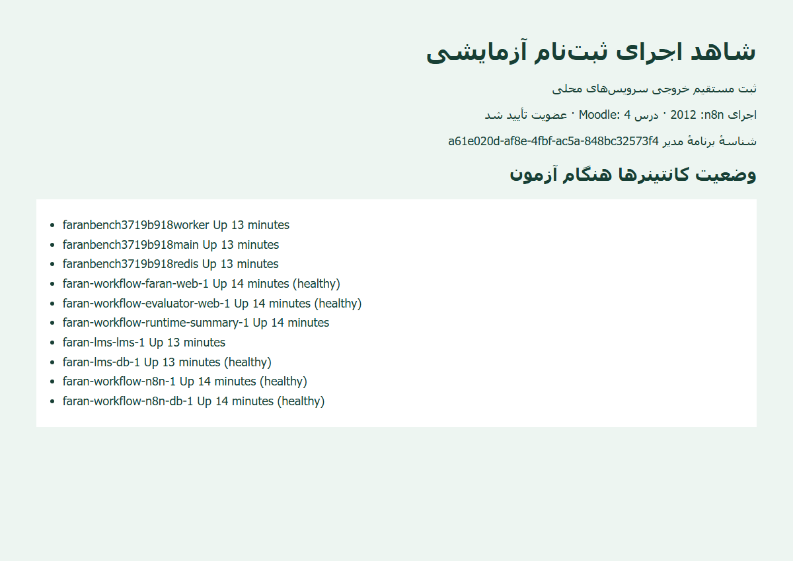
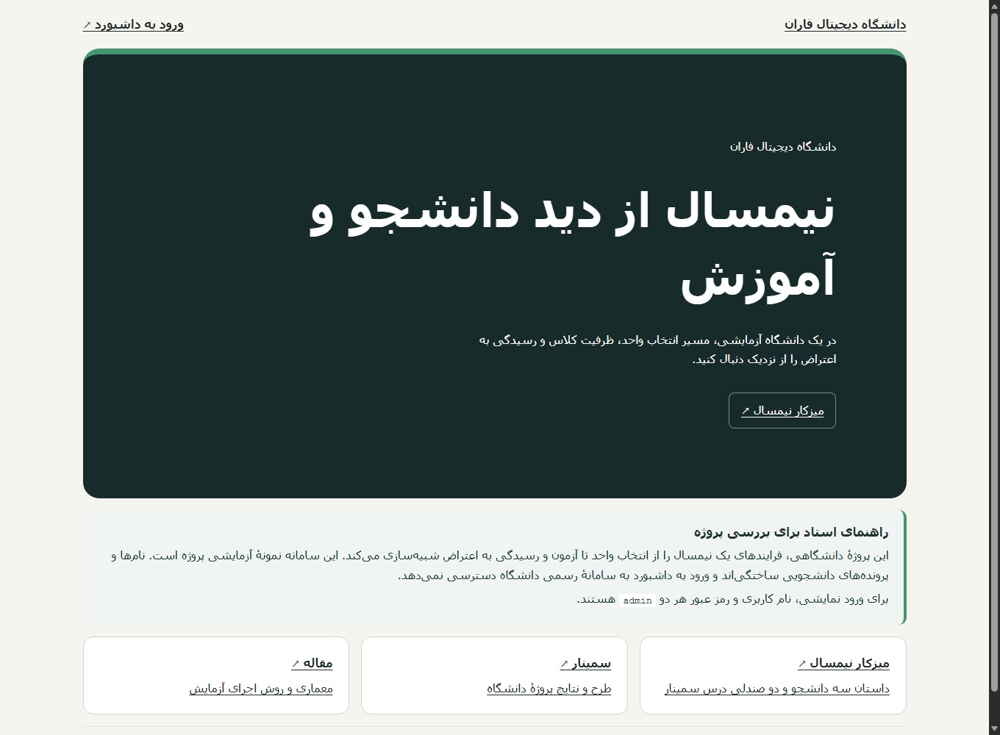
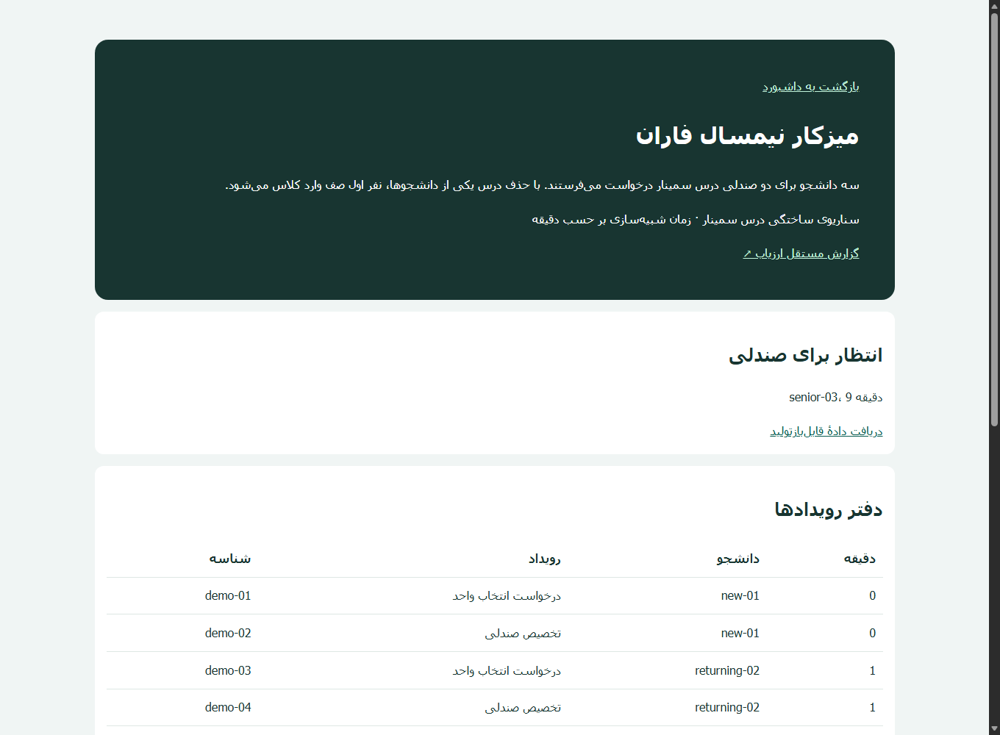

# دانشگاه ایجنتیک فاران: طرحی برای سازمان آموزشی چندعاملی

**نوع سند:** مقالهٔ طراحی و گزارش نمونهٔ نرم‌افزاری، نسخهٔ ۰٫۲
**درس:** سمینار
**استاد ارائه:** دکتر سعید شکراللهی، مطابق اعلام مالک پروژه.
**دانشجو:** محمد مهرانی.

## چکیده

این پروژه طرح یک محیط دانشگاهی چندعاملی را ارائه می‌کند که در آن ساختار علمی، آموزش، فناوری و عملیات در یک سازمان قابل مشاهده‌اند. مسئله فقط تعریف نقش برای عامل‌ها نیست؛ کار باید به درس و هدف آموزشی وصل شود، ابزار مجاز و بازبین داشته باشد و نتیجه‌اش برای ارزیابی بعدی ثبت شود. نسخهٔ حاضر یک نمونهٔ محلی و ساختگی از این طرح است. درس محکم‌بان را به‌عنوان مسیر سرتاسری انتخاب می‌کند: تعریف تمرین دفاعی، تخصیص تیم، اجرای fixture آفلاین و تولید رویداد نسخه‌دار. این نمونه کارکرد آموزشی واقعی، خودمختاری عامل‌ها یا اتصال به LMS را اثبات نمی‌کند.

## مسئله و مبنای طراحی

سامانهٔ آموزشی معمولاً میان چارت سازمان، برنامهٔ درسی، ابزارهای دیجیتال و اندازه‌گیری نتیجه پیوند می‌خواهد. مدل‌های مرجع آموزش عالی EDUCAUSE/HERM امکان توصیف قابلیت‌های کسب‌وکار، داده و برنامه را فراهم می‌کنند؛ خود EDUCAUSE آن‌ها را نقطهٔ شروع برای مدل‌سازی می‌داند، نه چارت اجباری. اصل حکمرانی مشترک AAUP یادآوری می‌کند که مسئولیت علمی و اجرایی دانشگاه باید روشن باشد؛ بیانیهٔ آن نمونهٔ حکمرانی خاص است و این مقاله آن را قانون فاران معرفی نمی‌کند. ISCED-F چارچوبی برای طبقه‌بندی حوزه‌های آموزشی است، اما نگاشت واقعی درس‌ها نیازمند مصوبات محلی است.

بنابراین فاران چهار سطح را از هم پیوند می‌دهد: حکمرانی، واحد سازمانی، برنامه و درس، و مأموریت اجرایی. عامل نقش و مسئولیت مشخص دارد؛ اختیارش محدود به ابزار و دادهٔ مجاز است. شورا و استاد می‌توانند کار علمی را بازبینی کنند. تصمیم انسانی، به‌ویژه دربارهٔ دسترسی یا نتیجهٔ آموزشی، در اختیار ایجنت قرار نمی‌گیرد.

## روش پیاده‌سازی نمونه

نسخه با HTML/CSS/JavaScript و کتابخانهٔ استاندارد Python ساخته شده است. داشبورد فارسی RTL به‌صورت PWA نصب‌پذیر است؛ پوستهٔ Android نیز با Capacitor تولید شده. seed محلی ۲٬۰۰۰ شناسهٔ نقش می‌سازد و ۱۴ نقش از آن‌ها را در سناریوی فعال نشان می‌دهد. چهار نقش مدیریتی تعریف‌شده از سوی مالک پروژه عبارت‌اند از خانم بیات، مدیر ارشد؛ دکتر فرخی، مدیر گروه IT؛ دکتر شکراللی، مدیر گروه مهندسی کامپیوتر؛ و خانم کلهرودی، مدیر آموزش.

اجرای نمونه شامل ثبت یک رویداد ساختگی با شناسه و schema ثابت، وضعیت کار، زمان، هزینهٔ صفر، نسخهٔ سیاست و شواهد fixture است. گزارش ارزیابی، مواردی چون اتمام اجرا، آفلاین‌بودن تمرین، عدم انتشار محتوای بازاریابی و هزینهٔ صفر را کنترل می‌کند. دادهٔ ثبت‌نام و هزینه، مصنوعی است. زمان‌بندی غیرفعال است.

## یافتهٔ فعلی و حدود نتیجه

در اجرای محلی قبلی، seed تعداد ۲٬۰۰۰ نقش ساخت و تکرار اجرای همان شناسهٔ کار، یک نتیجهٔ نهایی باقی گذاشت. این بررسی نشان می‌دهد مدل داده و نمونهٔ CLI کار می‌کنند؛ آزمون بار، ساخت APK، ایمنی یک اتصال واقعی، نتیجهٔ یادگیری یا کیفیت تدریس را اثبات نمی‌کند. اجرای UI جدید نیز هنوز باید در مرورگر و آزمون موبایل بررسی شود.

LMS مالک دو درس «سمینار» و «ارزیابی کارایی سیستم‌های کامپیوتری» را نشان داد. مالک پروژه تأیید کرده است که دانشگاه ایجنتیک فاران برای درس سمینار، با ارائه به دکتر سعید شکراللهی و دانشجویی محمد مهرانی، آماده می‌شود. سامانهٔ ارزیاب مستقل نیز برای درس ارزیابی کارایی سیستم‌های کامپیوتری، با ارائه به دکتر علی سلیمانی و همان دانشجو تعریف شده است. نام استاد سمینار در این مقاله مطابق اعلام دانشجو ثبت شده است.

## بحث

مزیت این مدل آن است که کیفیت کار به یک امتیاز کلی فروکاسته نمی‌شود: نقش و مدیر، هدف آموزشی، ورودی و ابزار مجاز، خروجی، شاهد و بازبین مشخص‌اند. گزارش ارزیابی می‌تواند شکست یک وظیفه یا ابهام قرارداد را به همان نقش پیوند دهد. اجرای نوبتی ۲٬۰۰۰ هویت با اجرای هم‌زمان آن‌ها یکی نیست و هیچ نتیجهٔ mock دربارهٔ ظرفیت مدل واقعی چیزی نمی‌گوید.

محدودیت بعدی اعتبار تعامل‌هاست. سناریوی mock نمی‌تواند کیفیت بازخورد آموزشی را بسنجد. برای آن باید rubric تصویب‌شده، مجموعهٔ سؤال/پاسخ مجاز و ارزیابی مستقل انسان فراهم شود. اتصال LMS هم نیازمند API رسمی، مجوز حداقل‌دسترسی و آزمون با دادهٔ ساختگی یا محیط staging است.

## نتیجه

نمونهٔ فاران یک مسیر قابل اجرا برای سازمان‌دهی نقش‌ها و ثبت خروجی ارزیابی می‌سازد. نسخهٔ بعدی باید قرارداد دانشگاه و ارزیاب را به‌صورت فایل تبادل کند و رفتار خطا، بازیابی، محدودیت بودجه و رابط موبایل را بررسی کند. مقاله تا انجام آن آزمون‌ها گزارش طراحی/نمونه باقی می‌ماند و نتیجهٔ تجربی یادگیری به آن نسبت داده نمی‌شود.

## منابع

1. EDUCAUSE. *The Higher Education Reference Models*. 2021. https://library.educause.edu/resources/2021/9/the-higher-education-reference-models (صفحهٔ معرفی بررسی شد؛ بستهٔ کامل مدل‌ها دریافت نشده است.)
2. AAUP. *Statement on Government of Colleges and Universities*. https://www.aaup.org/reports-publications/aaup-policies-reports/topical-reports/statement-government-colleges-and
3. UNESCO Institute for Statistics. *ISCED Fields of Education and Training 2013: Detailed field descriptions*. https://www.uis.unesco.org/sites/default/files/medias/fichiers/2025/04/international-standard-classification-of-education-fields-of-education-and-training-2013-detailed-field-descriptions-2015-en.pdf

---

**یادداشت ویراستاری:** متن بر پایهٔ Persian Writing و Humanizer بازبینی شده است: ادعاهای طرح از نتیجهٔ آزمون جدا شده‌اند، اصطلاحات محدود شده‌اند و نامعلوم‌های تحویل آشکار مانده‌اند. این بازبینی نشانهٔ داوری علمی یا تضمین اعتبار مقاله نیست.

## مطالعهٔ موردی دپارتمان‌های فاران

در ۲۳ نوامبر ۲۰۲۶ ابتدا تاریخچهٔ خالی دانشگاه ثبت شد. سپس برای چهار نقش، چهار مأموریت محلی تعریف شد. مدیریت دانشگاه طرح پروژه را خواند، آموزش فهرست درس نمونه را بررسی کرد، مهندسی کامپیوتر مقالهٔ سمینار را خواند و فناوری اطلاعات پیکربندی سرویس‌ها را بررسی کرد. هر برنامه پس از خواندن فایل، تعداد خطوط غیرخالی را گزارش داد. خطای خواندن یا خالی بودن فایل باعث شکست برنامه می‌شد.

| نقش | موضوع بررسی | نتیجهٔ ثبت‌شده |
|---|---|---|
| مدیریت دانشگاه | طرح پروژه | موفق |
| مدیریت آموزش | درس سمینار | موفق |
| مهندسی کامپیوتر | مقالهٔ سمینار | موفق |
| فناوری اطلاعات | پیکربندی محلی | موفق |

در این مشاهده، دانشگاه توانست چهار مسئولیت را به چهار اجراکننده بسپارد و برای هر اجرا سابقه‌ای جدا نگه دارد. درس سمینار نیز در Moodle ایجاد شده بود. این دو مشاهده به دو مسیر جدا تعلق دارند. هنوز از تغییر یک تکلیف در Moodle، اجرای خودکار عامل و بازگشت نتیجه به همان تکلیف شواهدی ثبت نشده است.

این بررسی با دادهٔ آزمایشی و برنامهٔ قطعی انجام شد. برای سنجش کیفیت آموزشی باید خروجی هر مأموریت با معیار از پیش تعیین‌شده و داوری مستقل مقایسه شود.

## بازتولید آزمون از راه‌اندازی Docker

برای درس سمینار، معیار آزمون این بود که برنامهٔ مدیر آموزش از گردش‌کار عبور کند و عضویت فعال دانشجوی آزمایشی در درس سمینار در Moodle تأیید شود.

Docker Desktop را راه‌اندازی کنید و با docker ps بالا بودن پایگاه داده، Moodle، Redis و worker را بررسی کنید. پس از آماده شدن n8n، گردش‌کار محلی ثبت‌نام را فراخوانی کنید. شناسهٔ اجرای n8n و شناسهٔ برنامهٔ مدیر را بردارید. سپس عضویت آزمایشی را از Moodle بازخوانی کنید. در اجرای ثبت‌شده، n8n شمارهٔ ۲۰۱۲ و Moodle درس شمارهٔ ۴ را گزارش کردند. مرحلهٔ بازخوانی با ابزار محلی انجام شد.

[شواهد JSON](execution-evidence.json)

## ضمیمهٔ فنی زبان‌ها و الگوریتم‌ها

### HTML و CSS

HTML ساختار معنایی صفحه، فرم، جدول و مقاله را تعریف می‌کند. CSS جهت راست‌به‌چپ، چیدمان واکنش‌گرا، رنگ و وضعیت تمرکز را تنظیم می‌کند. این دو بخش رابط‌اند.

### JavaScript و Node.js

JavaScript منو، رویدادهای فرم و کنترل‌های داشبورد را اجرا می‌کند. فایل‌های .mjs ماژول‌های JavaScript هستند. فایل sw.js کش رابط مرورگر را مدیریت می‌کند. نشست نمایشی با sessionStorage نگه‌داری می‌شود.

### Java، Gradle و Capacitor

MainActivity.java نقطهٔ ورود بستهٔ اندروید است. Gradle فرایند ساخت را تنظیم می‌کند و Capacitor دارایی‌های وب را در پوستهٔ اندروید نمایش می‌دهد. منطق آموزشی یا آماری به Java منتقل نشده است.

### قالب‌ها و ابزار اجرا

JSON قالب تبادل رویداد و تعریف گردش‌کار است. YAML تنظیمات Compose یا GitHub Actions را نگه می‌دارد. SQL برای پرس‌وجو و نگه‌داری داده به‌کار می‌رود. تصویر به‌تنهایی جایگزین سند JSON نیست.

### Python و PowerShell

Python در faran.py نقش‌ها و اجرای نمونه را مدیریت می‌کند. اسکریپت‌های Python شواهد آزمون را گردآوری می‌کنند. PowerShell برای راه‌اندازی محلی، واردکردن گردش‌کار و پشتیبان‌گیری است.

### PHP و Moodle

trace-enrol.php از API داخلی Moodle برای ثبت‌نام و بازخوانی عضویت فعال استفاده می‌کند. مسیر آزمایشی رقابت ظرفیت در race-seat.php بررسی و انتقال را با قفل ردیف گروه مقصد در یک تراکنش انجام می‌دهد.

### ساخت نقش و شناسهٔ پایدار

نقش‌ها با شناسهٔ role-0001 تا role-2000 در نگاشت قرار می‌گیرند. تولید و ادغام متوسط O(R)، و مرتب‌سازی خروجی O(R log R) است. اجرای نمونه با شناسهٔ تسک موجود، نتیجهٔ ذخیره‌شده را برمی‌گرداند. تعداد نقش تعریف‌شده شاخص تعداد اجرا نیست.

### صف ظرفیت و اعتبارسنجی عضویت

در سناریوی نیمسال، پس از آزاد شدن صندلی اولین نفر صف انتخاب می‌شود. deque درج و برداشت را با هزینهٔ سرشکن O(1) انجام می‌دهد. رخدادهای زمان‌دار در صف اولویت قرار می‌گیرند و عملیات آن O(log E) است. در آزمون عملیاتی، شاهد نهایی عضویت فعال در Moodle است.

### مرز اعتبار نتیجه

اجرای n8n شمارهٔ ۲۰۱۲ و تأیید عضویت Moodle در درس شمارهٔ ۴، شاهد یک مسیر مشخص‌اند. سناریوی نیمسال با دادهٔ ساختگی تهیه شده است. از آن نمی‌توان دربارهٔ هم‌زمانی همهٔ نقش‌ها یا سیاست رسمی دانشگاه نتیجه گرفت.

## نمودارهای معماری و گردش‌کار

