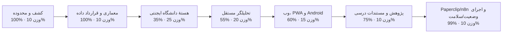

# وضعیت تحویل دانشگاه فاران و ارزیاب دکتر سلیمانی

**آخرین به‌روزرسانی:** ۱۴۰۵/۰۹/۰۲ · **نوبت کاری:** ۲۴
این امتیاز، شاخص برنامه‌ریزیِ تحویل بر مبنای معیارهای پذیرش است؛ درصد خطوط کد نیست. گراف وابستگی برای یافتن ارتباط فایل‌ها استفاده می‌شود و هر فاز فقط با شواهد کارکردی/مستند امتیاز می‌گیرد. اجراهای workflow در runtime واقعی n8n ثبت شده‌اند؛ کارت ورود به پنل بومی فقط برای میزبان محلی اضافه شد. مرور بصری مرورگر انجام نشد چون افزونهٔ مرورگر متصل نبود.

## پیشرفت کل دو پروژه و محیط ورک‌فلو: ۶۶٫۲٪

محاسبه: `۰٫۱۰×۱۰۰ + ۰٫۱۰×۱۰۰ + ۰٫۲۵×۳۵ + ۰٫۲۰×۵۵ + ۰٫۱۵×۶۰ + ۰٫۱۰×۷۵ + ۰٫۱۰×۹۹ = ۶۶٫۱۵٪` (نمایش گرد‌شده: ۶۶٫۲٪).

| فاز | وزن | پیشرفت فاز | شواهد موجود | ماندهٔ اصلی |
|---|---:|---:|---|---|
| ۰. کشف و محدوده | ۱۰٪ | ۱۰۰٪ | دو مخزن، سایت‌های فعلی، منابع معماری، گزینه‌های Paperclip/n8n/Dapr و گراف کد بررسی شدند | تأیید نیازهای استقرار و فرم رسمی تحویل |
| ۱. معماری و قرارداد | ۱۰٪ | ۱۰۰٪ | دو محصول جدا، قرارداد رویداد نسخه‌دار، مرز امنیت و مسیرهای اجرا مستند شدند | بازبینی استاد/مالک روی rubric نهایی |
| ۲. دانشگاه ایجنتی | ۲۵٪ | ۳۵٪ | داشبورد/CLI ساختگی، شرکت و پروژهٔ محلی Paperclip، چهار درخواست جذب نقش‌های شبیه‌سازی‌شده در وضعیت تأیید انسانی، بودجهٔ صفر و heartbeat خاموش | اتصال داشبورد دانشگاه به backend، انتخاب ارائه‌دهنده/سقف هزینه، تأیید و پیکربندی عامل‌ها، اجرای واقعی عامل و دیدن run عامل‌محور |
| ۳. ارزیاب دکتر سلیمانی | ۲۰٪ | ۵۵٪ | هستهٔ قطعی، ورودی JSON، نرخ‌ها/خطاها/روند محدود، فیلتر و خروجی JSON/CSV/چاپ؛ workflow دستی پالایش تاریخچهٔ Paperclip وارد n8n شد و feed بدون جعل شواهد به‌صورت فایل به ارزیاب داده می‌شود | اجرای موفق workflow feed از UI، ثبت اجرای واقعی عامل، benchmark/rubric و اعتبارسنجی اصالت منبع |
| ۴. وب، PWA و Android | ۱۵٪ | ۶۰٪ | دو سایت RTL در Docker با Nginx، وضعیت سلامت، دسترسی loopback و پروفایل hardening بالا می‌آیند؛ PWA و پوسته‌های Capacitor وجود دارند | نصب/آفلاین/دسترس‌پذیری، ساخت APK و مرور بصری تغییرات اخیر هنوز تأیید نشده |
| ۵. پژوهش و مستندات | ۱۰٪ | ۷۵٪ | مقاله و منابع اولیه برای هر پروژه، مشخصات درس/استاد/دانشجو، دو README فارسی کامل | تطبیق با rubric استاد، بازبینی نهایی منابع و متن توسط دانشجو |
| ۶. Paperclip/n8n و اجرای زنده | ۱۰٪ | ۹۹٪ | n8n و PostgreSQL سالم‌اند؛ Paperclip محلی پاسخ ۲۰۰ می‌دهد؛ سلامت، نقش‌ها و snapshot ترکیبی با اجرای موفق ثبت شده‌اند؛ خواندن نقش‌ها با credential رمز‌شدهٔ n8n و کلید Board زمان‌دار احراز شد؛ کلید پیشین باطل شد؛ restart تمیز تاریخچه و شناسه‌ها را حفظ کرد؛ بستهٔ backup ساخته شد و dump هر دو پایگاه در محیط جدا بازیابی شد؛ تماس‌های اختیاری n8n به MCP/قالب‌ها/اعلان نسخه/diagnostics خاموش است؛ داشبورد محلی پیوند محلی به ویرایشگر بومی دارد | کلید محدود/احراز production (Paperclip Board keyها scope ندارند)، پل issue/agent، راه‌اندازی کامل برنامه پس از restore و استقرار ۲۴/۷ باقی است |

## درصد ورک‌فلو به‌صورت جداگانه

صفحهٔ [نقشهٔ فازهای Paperclip/n8n](WORKFLOW-ROADMAP.md) پیشرفت مستقل **۷۸٪** را نشان می‌دهد؛ feed تاریخچهٔ Paperclip اجرا و در PostgreSQL ذخیره شده، ولی UI ارزیاب همچنان import فایل دستی می‌خواهد. این شاخص با پیشرفت کل یکی نیست. Paperclip اجرای عاملی ثبت نکرده؛ چهار نقش ساختگی فقط در انتظار تأییدند و ارائه‌دهندهٔ مدل نداریم.

## گزارش نوبت‌ها

| نوبت | تغییرات ثبت‌شده | وضعیت بعد از نوبت |
|---|---|---:|
| ۱ | کشف دو مخزن، مشاهدهٔ محدود LMS، طراحی تفکیک دانشگاه/ارزیاب و قرارداد رویداد | baseline فازهای بالا |
| ۲ | Compose محلی Paperclip/n8n/Postgres، رازهای محلیِ نادیده‌گرفته‌شده توسط Git، workflow دستی سلامت، معماری و runbook | ورک‌فلو ۴۰٪ |
| ۳ | ابزار گزارش در هر دو داشبورد (جست‌وجو/فیلتر، JSON، CSV و چاپ)، مشخصات تحویل و README فارسی کامل برای هر مخزن؛ ایندکس تازهٔ گراف کد هر دو پروژه | کل پروژه ۵۶٫۵٪؛ ورک‌فلو ۴۰٪ |
| ۴ | n8n و PostgreSQL سالم؛ workflow سلامت فقط‌خواندنی در پایگاه داده وارد و غیرفعال است. نام استاد فاران مطابق تأیید دانشجو در مقاله و نقشهٔ پروژه اصلاح شد. | کل پروژه ۶۰٫۵٪؛ ورک‌فلو ۵۰٪ |
| ۵ | Paperclip CLI محلی و loopback پاسخ ۲۰۰؛ workflow دستی سه‌گرهی یک‌بار اجرا و به‌صورت execution 1/success در PostgreSQL ذخیره شد؛ n8n پس از اجرا دوباره سالم است. Paperclip تا خروج/راه‌اندازی‌مجدد دستگاه به‌صورت فرایند پس‌زمینه می‌ماند؛ سرویس/خودراه‌انداز ویندوز نصب نشده. گراف کد فاران به ۳۴۰ گره و ۴۱۵ رابطه تازه شد. | کل پروژه ۶۱٫۵٪؛ ورک‌فلو ۵۸٪ |
| ۶ | شرکت آزمایشی فاران و پروژهٔ سمینار در Paperclip ساخته شدند؛ چهار درخواست جذبِ نقش‌های عمومی/شبیه‌سازی‌شده ساخته شده‌اند. همه pending approval، heartbeat خاموش و بودجه صفر است؛ هیچ عامل اجرا یا provider به کار گرفته نشد. | کل پروژه ۶۲٫۸٪؛ ورک‌فلو ۵۸٪ |
| ۷ | گردش‌کار دستی/غیرفعالِ خواندن وضعیت چهار نقش در n8n اضافه شد؛ خروجی نهایی فیلدهای حساس/غیرضروری Paperclip را کنار می‌گذارد. execution 3 با سه نود موفق در پایگاه داده ذخیره شد؛ execution 2 خطای اولیهٔ شکل داده را ثبت کرد و سپس کد اصلاح شد. سرویس‌های محلی بعد از اجرا سالم‌اند. | کل پروژه ۶۳٫۳٪؛ ورک‌فلو ۶۲٪ |
| ۸ | Task Scheduler داخلی ویندوز برای حساب فعلی نصب و با اجرای دستی trigger تأیید شد؛ Docker Desktop و n8n/PostgreSQL بالا می‌آیند و Paperclip سلامت ۲۰۰ می‌دهد. task فقط هنگام ورود کاربر اجرا می‌شود، رمز ذخیره نمی‌کند و routineهای ایجنت/n8n را فعال نمی‌کند. چون VPS/دسترسی تولیدی فراهم نشده، درصد پذیرش ۲۴/۷ افزایش نیافت. | کل پروژه ۶۳٫۳٪؛ ورک‌فلو ۶۲٪ |
| ۹ | snapshot یکپارچهٔ Paperclip health و وضعیت چهار نقش به n8n اضافه شد؛ execution 4 موفق است. پس از مشاهدهٔ تماس اختیاری n8n به رجیستری MCP، ماژول MCP و تماس‌های اعلان نسخه/قالب/diagnostics خاموش و سرویس با تنظیمات جدید بازسازی شد؛ سلامت ۲۰۰ و لاگ تازه بدون خطای رجیستری تأیید شد. | کل پروژه ۶۳٫۵٪؛ ورک‌فلو ۶۴٪ |
| ۱۰ | روی داشبورد محلی فاران کارت جداگانه‌ای برای بازکردن n8n اضافه شد؛ در hostname عمومی نمایش داده نمی‌شود و هیچ اعتبارنامه یا پاسخ API در کد فرانت‌اند نیست. نسخهٔ کش PWA بالا رفت تا کارت در نصب‌های بعدی تازه شود. | کل پروژه ۶۳٫۶٪؛ ورک‌فلو ۶۵٪ |
| ۱۱ | شناسه‌های workflow در فایل‌های نسخه‌دار ثابت شدند؛ اسکریپت import همه را در DB موجود به‌روزرسانی کرد و سه workflow غیرفعال، executionهای ۱ تا ۴ و سلامت هر دو سرویس حفظ شد. درصد تغییر نکرد؛ ورود مالک و استقرار ۲۴/۷ هنوز معیارهای پذیرفته‌شده نیستند. | کل پروژه ۶۳٫۶٪؛ ورک‌فلو ۶۵٪ |
| ۱۲ | n8n/PostgreSQL تمیز متوقف و با Task Scheduler دوباره بالا آورده شدند؛ سه workflow، وضعیت غیرفعال و executionهای ۱ تا ۴ حفظ شدند و Paperclip پاسخ ۲۰۰ داد. این restart آزمایش شد، اما بازیابی backup یا رفتار پس از خاموشی کامل دستگاه نه. | کل پروژه ۶۳٫۶٪؛ ورک‌فلو ۶۷٪ |
| ۱۳ | اسکریپت دستی و بدون زمان‌بندی برای پشتیبان‌گیری محلی اضافه شد. بستهٔ محدودشده با ACL شامل dump پایگاه‌های Paperclip و n8n، کلیدها، تنظیمات، پوشهٔ پایدار n8n، فایل اسرار و SHA-256 است. هر دو dump در PostgreSQL موقت جداگانه بازیابی شدند: ۳۲۰ جدول عمومی Paperclip و ۱۷۳ جدول n8n. بالا آمدن کامل برنامه، رمزگشایی اعتبارنامه‌ها و بازیابی فایل‌های Paperclip هنوز تأیید نشده است. | کل پروژه ۶۳٫۷٪؛ ورک‌فلو ۷۰٪ |
| ۱۴ | endpoint فهرست چهار نقش با کلید ۳۰روزهٔ Paperclip احراز شد؛ کلید به‌صورت credential رمز‌شده در n8n ذخیره شد و دو workflow محلیِ فقط‌خواندنی به آن ارجاع می‌دهند. اجرای یک‌بارهٔ snapshot ترکیبی موفق بود و در جدول execution برای همان workflow ثبت شد؛ سپس سرویس n8n سالم بالا آمد. کلید مدیریتیِ گسترده فقط برای sandbox loopback است؛ حساب مالک n8n و اتصال واقعی issue/task هنوز آماده نیستند. | کل پروژه ۶۳٫۷٪؛ ورک‌فلو ۷۳٪ |
| ۱۵ | credential با کلید ۳۰روزهٔ تازه چرخانده و از stdin وارد n8n شد؛ workflowهای محلی به credential تازه ارجاع دارند. اجرای snapshot موفق شد. کلید قبلی باطل و پاسخ endpoint برای آن ۴۰۱ تأیید شد. سرویس n8n سالم ماند و backup تازه با ۹ checksum ساخته شد. یک credential رمز‌شدهٔ بلااستفاده برای کلید باطل‌شده در n8n باقی است و پس از راه‌اندازی مالک پاک می‌شود. فایل staging قدیمی فقط کلید باطل‌شده را دارد و همچنان Git-ignored/ACL-restricted است؛ پاک‌سازی دستی آن در README آمده است. | کل پروژه ۶۳٫۷٪؛ ورک‌فلو ۷۴٪ |

## گراف کد و شیوهٔ امتیازدهی

گراف ایستای وابستگی سورس در ۱۴۰۵/۰۹/۰۱ به‌روزرسانی شد. Graphify در محیط نصب نبود؛ برای این کار از سرویس گراف کدِ موجود استفاده شد:

- فاران: ۳۴۰ گره، ۴۱۵ رابطه؛ دو فایل Gradle بخشی هستند؛ فایل `app.js` کامل parse شد. گراف در نوبت ۵ بعد از افزودن فایل workflow محلی تازه‌سازی شد.
- ارزیاب: ۱۸۷ گره، ۲۳۱ رابطه؛ `index.html` و دو فایل Gradle بخشی هستند؛ فایل `app.js` این‌بار کامل parse شد.
- `docs/`، `node_modules/`، `www/` و پوشه‌های build از نمای کد حذف شده‌اند؛ پس نمودار دربارهٔ متن مستندات یا اجرای زنده شاهدی نمی‌دهد.

گراف برای وابستگی و مسیرهای کد است؛ درصدها از معیارهای پذیرش جدول و خروجی‌های قابل مشاهده/مستند حاصل می‌شوند. با هر نوبت کاری، این جدول، درصدها و گزارش نوبت به‌روز می‌شوند.

| ۱۴ | endpoint فهرست چهار نقش با کلید Board زمان‌دار احراز شد؛ credential به‌صورت رمز‌شده در n8n ذخیره و اجرای ترکیبی پس از چرخش کلید موفق شد. | کل پروژه ۶۳٫۷٪؛ ورک‌فلو ۷۳٪ |
| ۱۵ | کلید تازه بدون ذخیرهٔ خام روی میزبان از stdin وارد n8n شد؛ کلید قبلی باطل شد و پاسخ آن ۴۰۱ بود. backup جدید با ۹ checksum ساخته شد. | کل پروژه ۶۳٫۷٪؛ ورک‌فلو ۷۴٪ |
| ۱۶ | مالک n8n حساب را تکمیل کرد. execution 5 در مرورگر بازبینی شد: چهار گره موفق، چهار نقش، ۴٫۵۷۸ ثانیه. با تأیید کاربر credential باطل و بی‌ارجاع حذف شد؛ credential فعال برای دو workflow باقی ماند. backup تازه پس از پاک‌سازی گرفته شد. | کل پروژه ۶۳٫۷٪؛ ورک‌فلو ۷۶٪ |
| ۱۷ | workflow دستی و غیرفعال پایش تسک Paperclip اضافه شد؛ execution 6 موفق است. خروجی حداکثر ۲۵ تسک با فهرست فیلدهای مجاز است و شرح/دیدگاه، ایجاد تسک یا بیدارکردن ایجنت ندارد. | کل پروژه ۶۳٫۷٪؛ ورک‌فلو ۷۷٪ |
| ۱۸ | شاخهٔ live-runs به مانیتور افزوده شد؛ task و runهای فعال با issue ID پیوند می‌خورند و خروجی شناسهٔ اجرای n8n دارد. execution 7 موفق است؛ workflowها غیرفعال‌اند. تحقیق Cloudflare Free و مخزن‌های معرفی‌شده مستند شد. | کل پروژه ۶۳٫۷٪؛ ورک‌فلو ۷۸٪ |
| ۱۹ | از داشبورد محلی به ویرایشگر n8n، نمودار task monitor و execution ثبت‌شده میان‌بر اضافه شد؛ در سایت عمومی پنهان است و credential ندارد. cache پوستهٔ PWA نسخه‌گذاری شد. | کل پروژه ۶۳٫۷٪؛ ورک‌فلو ۷۸٪ |
| ۲۰ | صفحهٔ محلی مرکز کنترل، چهار workflow و لینک اجرای native آن‌ها اضافه شد؛ خلاصه صریحاً ثابت/غیرزنده است. به‌دلیل پاسخ‌ندادن registry، کتابخانهٔ canvas نصب نشد. | کل پروژه ۶۳٫۷٪؛ ورک‌فلو ۷۸٪ |
| ۲۱ | Docker Desktop با engine pipe خاموش پیدا شد و دوباره راه‌اندازی شد. n8n/PostgreSQL از volumeهای موجود برگشتند؛ Paperclip نیز پس از startup طولانی HTTP ۲۰۰ داد. راه‌انداز برای cache ناقص npm اصلاح شد؛ چهار workflow همچنان غیرفعال‌اند. | کل پروژه ۶۳٫۷٪؛ ورک‌فلو ۷۸٪ |
| ۲۲ | کاتالوگ نقش‌محور مهارت/اختیار و rubric ایجنت‌ها با منابع اولیهٔ AppSec، dependency/SBOM، Sigma، ATT&CK، OSINT دارایی‌های مالکیت‌شده و privacy ثبت شد؛ ستون مهارت‌های پایه به فهرست ایجنت‌ها افزوده شد. مهارت‌ها نمایشی‌اند و هیچ اسکن/سرویس بیرونی/runner فعال نشده است. مخزن‌های ستاره‌شدهٔ تهاجمی یا حساس از نظر داده وارد نشدند. | کل پروژه ۶۳٫۷٪؛ ورک‌فلو ۷۸٪ |
| ۲۳ | شمارنده‌ها را با دادهٔ runtime تطبیق دادم: فایل محلی `.faran/state.json` دقیقاً ۲٬۰۰۰ شناسهٔ Mock و ۱۴ نقش فعال سناریو دارد؛ Paperclip چهار agent رکوردشده دارد که همگی `pending_approval` هستند، با adapter `process` و بدون model/provider. متن داشبورد صریحاً تفاوت این دو شمارش را نشان می‌دهد. Docker Engine و n8n/PostgreSQL سالم‌اند؛ انتقال Paperclip به container هنوز شروع نشده تا image و مسیر داده جداگانه بررسی شود. | کل پروژه ۶۳٫۷٪؛ ورک‌فلو ۷۸٪ |
| ۲۴ | دو پنل RTL با image رسمی Nginx پین‌شده، portهای loopback، healthcheck و filesystem فقط‌خواندنی در Docker ساخته و بالا آورده شدند؛ هر دو HTTP ۲۰۰ و health سالم دادند. Feed دستی Paperclip→ارزیاب ساخته، غیرفعال import و با CLI اجرا شد؛ اجرای نهایی سه گره موفق داشت و JSON قرارداد `faran-event-schema/1.0` را با `connected-no-runs` در PostgreSQL ثبت کرد. برای عبور گرهٔ پاک‌سازی از خروجی خالی HTTP، `alwaysOutputData` تنظیم شد. n8n پس از اجرای آزمایشی سالم restart شد. | کل پروژه ۶۶٫۲٪؛ ورک‌فلو ۷۸٪ |

## صف ادامهٔ کار

۱. طراحی پل task/issue با فیلتر داده و نمایش وضعیت/نتیجهٔ agent در n8n؛ scheduleها تا تعیین تناوب و سقف هزینه خاموش بمانند.  
۲. تکمیل گزارش‌های دانشگاه و ارزیاب، بازبینی accessibility/RTL و مرور بصری.  
۳. ساخت مسیر واقعی n8n ↔ Paperclip با correlation/idempotency و نمایش آخرین run از APIهای احراز هویت‌شده.  
۴. تکمیل پکیج‌های APK پس از رفع نیازهای محیط Android.  
۵. انتشار پایدار ۲۴/۷ تنها پس از فراهم‌شدن Linux VPS، دامنه/منطقهٔ Cloudflare، سیاست Access، کلیدهای لازم و برنامهٔ هزینه/اجرا.
