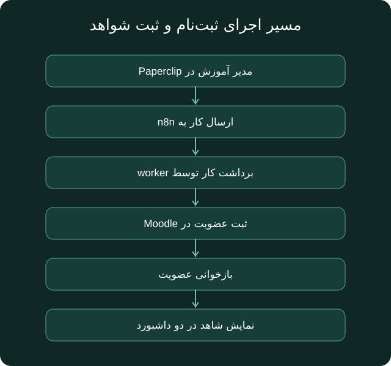
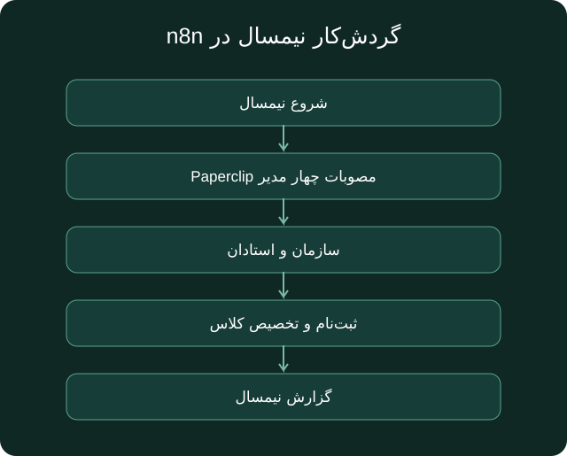
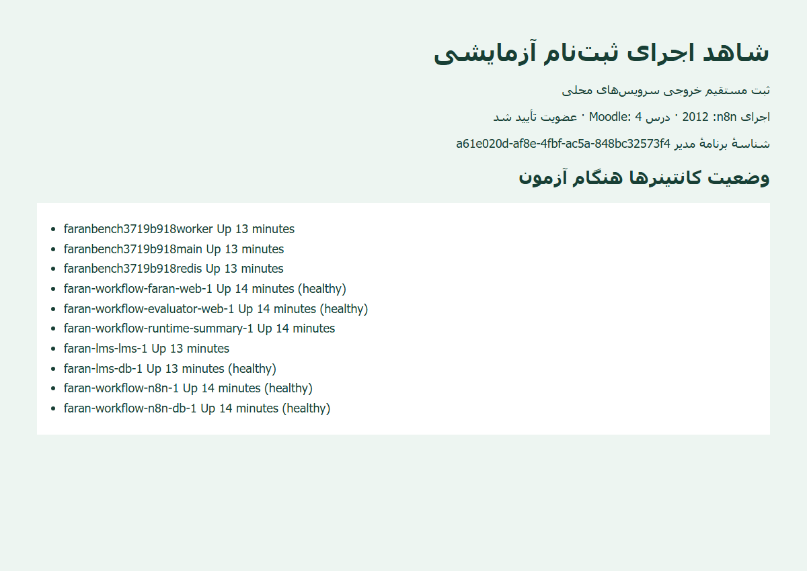

# گزارش سمینار دانشگاه دیجیتال فاران

**دانشجو:** محمد مهرانی  
**استاد:** دکتر سعید شکراللهی  
**موضوع:** طراحی، پیاده‌سازی و ارزیابی یک نمونهٔ دانشگاه دیجیتال چندعاملی

## چکیده

این پژوهش بررسی می‌کند چگونه می‌توان یک درخواست آموزشی را از تصمیم مسئول آموزش تا ثبت نتیجه در سامانهٔ مدیریت یادگیری رهگیری کرد. نمونهٔ فاران سه مسئولیت دارد: مدیریت مأموریت، اجرای گردش‌کار و ثبت وضعیت آموزشی. Paperclip برای برنامهٔ مدیریتی، n8n برای اجرای گردش‌کار و Moodle برای ثبت عضویت استفاده می‌شوند. مرجع تشخیص موفقیت، بازخوانی عضویت در سامانهٔ آموزشی است. ثبت موفق یک گردش‌کار به‌تنهایی برای تأیید ثبت‌نام کافی نیست. در نمونهٔ ثبت‌شده، شواهد اجرای شمارهٔ ۲۰۱۲ به عضویت فعال در درس شمارهٔ ۴ پیوند داده شد. آزمایش ظرفیت نیز نشان داد که دو درخواست هم‌زمان از مسیر قفل‌شده تنها یک صندلی را اشغال کردند. این مشاهدات به محیط محلی و پرونده‌های ساختگی مربوط‌اند.

## پرسش‌های پژوهش

۱. چگونه می‌توان تصمیم مدیر، اجرای گردش‌کار و نتیجهٔ آموزشی را با شناسه‌های قابل تطبیق دنبال کرد؟

۲. در صورت رقابت دو دانشجو برای آخرین صندلی، چگونه می‌توان ظرفیت گروه مقصد و عضویت اولیهٔ دانشجوی بازنده را حفظ کرد؟

۳. برای تحلیل تأخیر چگونه باید زمان صف، زمان خدمت و فاصلهٔ میان مراحل را تعریف کرد؟

## روش پژوهش

واحد مشاهده یک درخواست آموزشی است. هر درخواست باید شناسه، نسخهٔ سیاست، نتیجه و مرجع سند داشته باشد. مطالعه سه منبع شواهد را کنار هم می‌گذارد: نتیجهٔ گردش‌کار، عضویت ثبت‌شده در Moodle و رویدادهای سناریوی نیمسال. نخستین و دومین منبع برای بررسی فنی یک اجرای محلی استفاده می‌شوند. منبع سوم امکان طرح پرسش‌های آموزشی را با دادهٔ ساختگی فراهم می‌کند.

معیار پذیرش ثبت‌نام وجود عضویت فعال برای دانشجوی آزمایشی در درس مورد انتظار است. در آزمون تغییر گروه، معیار پذیرش وجود یک عضو در گروه مقصد و حفظ عضویت مبدأ برای دانشجوی منتقل‌نشده است. در آزمون تأخیر، آغاز و پایان هر بازه باید از منبع ثبت‌کنندهٔ همان بازه استخراج شود.

## معماری سامانه

مرورگر صفحهٔ عمومی و داشبورد نمایشی را ارائه می‌کند. گردش‌کار آزمایشی در n8n محلی اجرا می‌شود. مدیر در Paperclip برنامهٔ مأموریت را تولید می‌کند. n8n نتیجه‌ای با شناسهٔ اجرا بازمی‌گرداند. در اجرای مستندشده، یک ابزار محلی مرحلهٔ عضویت Moodle را انجام داده و پس از آن عضویت فعال را بررسی کرده است. بدین ترتیب مرز اجرای گردش‌کار و مرز تغییر دادهٔ آموزشی مشخص است.

## تحلیل رقابت ظرفیت

اگر دو درخواست ابتدا ظرفیت را بخوانند و پیش از ثبت نتیجهٔ یکدیگر پیش بروند، هر دو ممکن است همان صندلی را آزاد ببینند. در مسیر آزمایشی، قفل ردیف گروه مقصد پیش از خواندن ظرفیت گرفته می‌شود. درخواست دوم بعد از پایان تراکنش نخست وضعیت گروه را می‌خواند. انتقال پس از تشخیص ظرفیت انجام می‌شود. شرط حفظ گروه مبدأ با بازخوانی هر دو عضویت پس از پایان تراکنش‌ها آزموده شد.

نتیجهٔ مشاهده‌شده، وقوع یک انتقال و حفظ گروه اولیه برای درخواست دیگر بود. این آزمون تضمین می‌کند که در همان اجرای ثبت‌شده هر دو شرط برقرار بوده‌اند. برای تعمیم نتیجه باید همهٔ مسیرهای ثبت عضویت، از جمله عملیات دستی، از سیاست رقابت سازگار پیروی کنند.

## تحلیل زمان انتظار

در اجرای شمارهٔ ۲۰، از فراخوانی CLI تا نخستین گره ۱۴٫۵۳۶ ثانیه گذشت. تطبیق زمان‌ها نشان داد ۱۲٫۷۸۸ ثانیه تا ایجاد رکورد، ۰٫۰۵۵ ثانیه تا ثبت شروع و ۱٫۶۹۳ ثانیه تا نخستین گره صرف شد. چون مسیر CLI مستقیم بود، این بازه شامل انتظار در Redis نبود. در آزمایش جداگانه با worker روشن، میانهٔ انتظار Redis در سه مشاهده ۶٫۷۵۵ میلی‌ثانیه بود. این اعداد برای محیط محلی و بار تک‌درخواستی گزارش می‌شوند. برای آزمون ازدحام باید نرخ ورود، هم‌زمانی و سهم هر مرحله مستقل ثبت شوند.

## شاهد اجرای ثبت‌نام

[دادهٔ اجرای شمارهٔ ۲۰۱۲](execution-evidence.json)

## محدودیت‌ها و نتیجه‌گیری

سیاست‌های سناریو با پرونده‌های ساختگی تعریف شده‌اند. نتیجهٔ یک درس آزمایشی دربارهٔ همهٔ رشته‌ها یا زیرساخت دانشگاه واقعی کفایت نمی‌کند. تعداد نقش‌های تعریف‌شده، تعداد اجراهای دارای شاهد و تعداد ایجنت‌های ثبت‌شده در سامانهٔ مدیریت سه اندازه‌گیری مستقل‌اند. ارزش نمونه در امکان تطبیق تصمیم، اجرا و نتیجه است. با همین مرزبندی می‌توان آزمون‌های ظرفیت، قابلیت بازیابی و کیفیت فرایند را به‌صورت قابل‌بازتولید گسترش داد.
