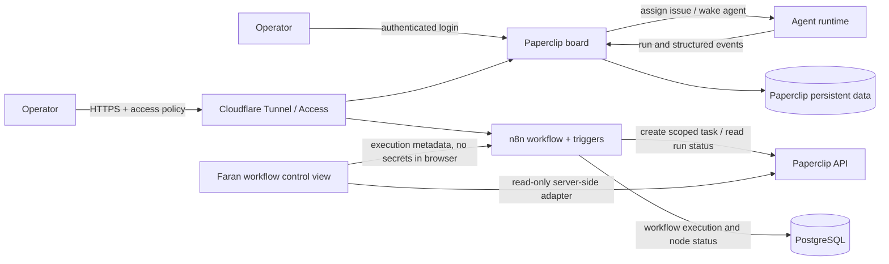

# Faran live workflow environment

Status: local foundation verified. Paperclip CLI and n8n/PostgreSQL are running on this Windows host; successful saved executions include health probe 1, role status 3, combined snapshot 5 and task monitor 6. A user-level logon task restores local services when the owner signs in. n8n MCP, template, diagnostics and version-notification outbound features are disabled. The snapshot returns Paperclip health plus four synthetic role statuses after filtering the roster response. The manual task monitor returns a bounded list with an explicit field allowlist, excluding task descriptions/comments and making no writes. The four role-hire requests remain pending approval, budgets are zero, heartbeats are disabled, and no model/provider is configured. End-to-end task-to-agent run correlation and always-on deployment remain unimplemented. The n8n owner account is claimed; execution 5 was reviewed in the browser with all four nodes successful. The Paperclip key used by n8n is a broad-scope board key (the API key schema has no permission scopes), so keep it confined to this loopback sandbox. The earlier key was revoked; the unused credential for the revoked key has been deleted with owner approval.

## Goal

Run the Faran workflow services independently of the browser, show each real run in its native workflow diagram, and give the operator a read-only view of agent tasks, node execution state, errors, and health. “Always on” means the services remain available and configured triggers can start work. It does not mean every agent continuously consumes model tokens. Agents wake for assigned work or an explicitly approved routine.

The implementation uses **Paperclip for agent organization, budgets, task assignment, wakeups, and run history**, and **n8n for the editable visual workflow, trigger orchestration, and per-node execution diagram**. The node graph shown by n8n is the source of truth; Faran will link to the native execution view rather than redraw a second graph that can drift.

## Reuse decision (checked 2026-11-22)

| Candidate checked | Version/source actually inspected | Licence and fit | Decision |
|---|---|---|---|
| Paperclip | [`paperclipai/paperclip`](https://github.com/paperclipai/paperclip), release `v2026.1117.0`, tag commit `c0f132898d2a2677312d8c72096187b27a3d9a38`; official Docker/deployment/API docs and installed `packages/shared/src/validators/access.ts` inspected | MIT. Current upstream requires Node 24.11+ and pnpm 9.15+ for source development; the pinned official Docker image avoids coupling runtime to this Windows Node install. Supports authenticated deployment, tasks/assignment, wakeups, routines, run event history and health API. The verified `createBoardApiKeySchema` accepts a label, expiry and optional company context but no permission scopes; board keys are broad-scope. | Reuse the official container and agent/task/run APIs. Keep broad board keys in the local sandbox only; do not implement a parallel agent company manager. |
| n8n | [`n8n-io/n8n`](https://github.com/n8n-io/n8n), release `n8n@2.48.7`, published 2026-11-20; official hosting, API and licence docs | Sustainable Use License / fair-code, not an OSI open-source licence. Self-hostable for internal/non-commercial use; redistribution or offering it as a paid hosted product may require a commercial agreement. Docker deployment and workflow execution API are documented. Use only for Faran's internal project automation unless the licence is reviewed for a broader offering. | Reuse the official self-hosted editor, workflow file format, execution records and native per-node execution diagram. Keep its API key server-side. |
| Dapr Workflows | [`dapr/dapr`](https://github.com/dapr/dapr), release `v1.19.2`; official workflow and dashboard docs | Apache-2.0 and durable workflow runtime. Its Dev Dashboard is documented for local development; using Dapr here would require a new application/runtime and separate dashboard path. It does not provide n8n's same no-code workflow authoring experience. | Defer. It is a credible durable-runtime option but adds a second custom workflow application without improving the requested visual authoring surface. |
| Cloudflare Tunnel | Existing local `cloudflared.exe`; official Cloudflare Tunnel docs | Tunnel creates outbound-only connectivity from an **already running host**. It does not run Paperclip/n8n or provide their persistent database. Public hostnames still need authentication policies and DNS/domain access. | Use only as the protected access path after an always-on Linux host and Cloudflare zone/account are available. |
| Graphify | Searched the installed skills and `mcp.so/skills`; no local Graphify skill was installed. The public Graphify projects reviewed are code knowledge-graph tools, not project-progress managers. | Installing a new third-party code would duplicate an available graph tool for this repository and would not calculate delivery completion. | Use the in-session Codebase Memory graph service to map source dependencies, and this weighted roadmap to calculate work progress. No Graphify package or hook installed. |
| Custom diagram renderer | Current Faran dashboard and actual n8n workflow graph/status APIs | A second renderer would have to reproduce n8n layout, branches, node run data and update semantics; it could display stale or fabricated state. | Do not create a competing canvas. The Faran control view can aggregate summaries and deep-link to Paperclip/n8n; n8n renders the exact workflow and run. |

The local owner capability catalogue was checked: `WF-ENGINE` (versioned workflow), `AI-EXEC` (controlled agent execution), `WF-TASK` (task lifecycle), `CORE-AUDIT` (change trace), and `CORE-IAM` (identity/authorization) are the applicable existing capability IDs. They are design references, not claims that these capabilities are implemented in the app.

## Proposed topology

**Control split:** Paperclip owns agent identity, assignment, execution policy and run history. n8n owns workflow definitions, event triggers, orchestration steps and the per-node visual trace. Faran's evaluator consumes only a minimal, synthetic or explicitly sanitized event contract. It cannot modify either engine or grant an agent new tools.

## Run lifecycle

1. An approved manual or recurring trigger starts one named/versioned n8n workflow.
2. n8n validates the task envelope, deduplicates its idempotency key, and records the correlation ID.
3. n8n creates or locates one Paperclip issue for the intended agent and wakes that agent; an existing accepted issue is not duplicated on retry.
4. Paperclip runs the assigned agent. Run events and n8n execution metadata are read separately from their source APIs.
5. A deterministic policy/quality gate marks the result for success, retry, human review or failure. Financial, HR, enrollment and publishing effects stay disabled in the initial live pilot.
6. The control view reports service health, workflow execution, Paperclip run, last event time and errors. Selecting a run opens the exact native n8n execution diagram or Paperclip run detail.

Schedule cadence, agent model/provider, monthly spend cap, maximum concurrency, and timezone are open configuration. All routines remain disabled until these parameters and model credentials are supplied; the services can be kept online and respond to an explicit manual trigger meanwhile.

## Operator journeys and acceptance

### Monitor the current run

Open Faran → Workflow Control → see Paperclip/n8n connectivity and the latest run → open the n8n execution → inspect actual node outcomes → open the linked Paperclip run for agent task/events. On a narrow/mobile screen, show summary cards first and keep the native diagram in its own responsive n8n page.

Implemented locally so far: when the Faran page hostname is `localhost` or `127.0.0.1`, its home page shows a separate link to the native n8n editor. Public-host pages omit it. The owner can sign in to n8n and inspect the combined snapshot or task-monitor execution in its native graph; Faran does not embed the graph or read execution data in the browser.

Acceptance:

- Service offline is shown as **disconnected/unknown**, never “running”.
- Run and node states come from Paperclip/n8n responses with source timestamp and run IDs.
- At least queued, running, waiting-for-human, succeeded, failed, canceled and stale states are distinguishable.
- A failed/expired API call leaves the last sample timestamp visible and marks data stale.
- Empty state explains that no connected execution has yet occurred; loading has a skeleton; errors offer a retry and source link.
- API keys, model keys, task payloads, prompt text and student data are never sent to browser JavaScript or public event exports.
- No schedule, retry, agent assignment or external effect is enabled merely by showing the diagram.

### Launch a controlled pilot

From Paperclip, operator assigns the approved Seminar task. The n8n workflow validates the event and its policy version, routes work to the named agent, and sends completion to a human review node. The operator can pause new dispatches without erasing in-flight audit records.

Acceptance:

- Every run has a stable `run_id`, `workflow_id`, `workflow_version`, `issue_id`, `correlation_id`, `trigger`, `started_at`, `ended_at`, `status`, `attempt`, and `source_timestamp`.
- A repeated request with the same idempotency key does not create a second issue or external effect.
- Retry is bounded and classifies transient, permanent, policy and unknown-outcome failures.
- Unknown external outcomes stop for human reconciliation; retry is never assumed safe.
- Role permissions, human approval and budget are enforced in the services, not only in prompts or UI.

## Error, empty and recovery states

| Condition | Shown state | Safe behavior |
|---|---|---|
| Engine not configured | Setup required | Do not fabricate live status or enable schedule |
| Engine unreachable/auth expired | Disconnected / stale | Keep last timestamp; no automatic writes |
| No execution history | Waiting for first run | Link to native n8n workflow editor and Paperclip board |
| Task rejected by policy | Blocked | Record reason and request human decision |
| Provider/network transient failure | Retry pending | Bounded backoff and same idempotency key |
| Execution crashed or result unknown | Needs reconciliation | Stop replay until source state is checked |
| Human approval needed | Waiting for review | No publication, grade, HR or finance action |

## Deployment boundary

The Faran public Vercel page is static and cannot host the persistent Paperclip or n8n server process. The local Docker Desktop Linux engine is running: n8n and its PostgreSQL 16 compatibility database report healthy. Paperclip is a loopback-only CLI service with persistent local storage. A user-level Windows Task Scheduler task now starts Docker Desktop, n8n/PostgreSQL and Paperclip when this account signs in; it does not run before sign-in, survive machine sleep/power-off, or provide 24/7 availability. This remains a local sandbox. A 24/7 deployment needs a Linux VPS/always-on server with persistent storage. Cloudflare can protect and route to that host; it is not a replacement for it. The production instance must not expose raw ports; Paperclip and n8n need authenticated logins, stable encryption secrets, restricted inbound access, persistent volumes and tested backup/restore.

The repo currently has no confirmed VPS destination, Cloudflare account/zone access, selected model provider/API credential, approved spend cap, schedule cadence, concurrency limit, or domain/subdomain. The n8n owner account is configured, and its encrypted credential store contains one active Paperclip board key referenced by the two local role-reading workflows. The paired browser extension was offline during this pass. Those are explicit production/agent-run prerequisites, not guesses.

## Sources inspected

- Paperclip source/release: `https://github.com/paperclipai/paperclip`, tag `v2026.1117.0`, commit `c0f132898d2a2677312d8c72096187b27a3d9a38`; official Docker, deployment mode, issue, agent wakeup, run events and health documentation.
- n8n source/release: `https://github.com/n8n-io/n8n`, tag `n8n@2.48.7`; official hosting, Sustainable Use License, REST API and execution documentation.
- n8n outbound-isolation configuration: `https://github.com/n8n-io/n8n-docs/blob/main/docs/deploy/host-n8n/configure-n8n/basic-configuration/configuration-examples/isolate-n8n.md`; MCP module disablement: `https://github.com/n8n-io/n8n-docs/blob/main/docs/connect/connect-to-n8n-mcp-server.md`.
- Dapr source/release: `https://github.com/dapr/dapr`, release `v1.19.2`; Dapr workflow management and Dev Dashboard docs.
- Cloudflare Tunnel: `https://developers.cloudflare.com/cloudflare-one/networks/connectors/cloudflare-tunnel/`, documentation last updated 2026-11-18.
- Project graph: Codebase Memory graph, refreshed 2026-11-22 to 340 nodes / 415 edges for the Faran root. The index intentionally excludes `docs/` and parts of the Android build; it is a code-relationship aid, not runtime evidence.
- Owner resource library: `D:/OB/03-Businesses/SourceCast-Research/48-اشتراک-دانش-با-کلاد-و-چرخه-تصمیم‌گیری.md`, `09-ماتریس-نیاز-و-امکانات.md`, `10-کاتالوگ-قابلیت‌ها.md`, `12-اتوماسیون-و-معماری.md`, and `Patterns/Workflow.md`.

