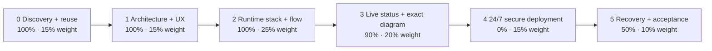

# Live workflow delivery roadmap

Scope: deliver the requested Paperclip + n8n environment with an accurate online execution diagram and phase-by-phase completion reporting. Percent is a weighted acceptance score for this workflow upgrade, not a count of changed files. Previous Faran/evaluator prototype work is outside this denominator.

## Overall progress: 78%

Calculation: `0.15×100 + 0.15×100 + 0.25×100 + 0.20×90 + 0.15×0 + 0.10×50 = 78%`.

## Weighted phases

| Phase | Weight | Current | Acceptance criteria |
|---|---:|---:|---|
| 0. Discovery and reuse decision | 15% | 100% | Existing repository, runtime availability, Paperclip/n8n/Dapr/Cloudflare docs, releases/licences, owner catalogue, and Graphify/code graph checked; selected roles recorded. |
| 1. Architecture and UX contract | 15% | 100% | Control boundaries, operator journeys, run envelope, empty/loading/error/mobile states, security rules, dependencies and acceptance criteria documented. |
| 2. Runtime stack and first workflow | 25% | 100% | Local n8n/PostgreSQL Docker services report healthy; Paperclip CLI runs on loopback with persistent local data and no model; the inactive manual health workflow is stored in PostgreSQL and has completed successfully. The local run path uses a separate host-gateway workflow file. |
| 3. Paperclip↔n8n run bridge and live status | 20% | 90% | Read-only health execution 1, role-status execution 3, combined snapshot execution 5 and task-monitor executions 6/7 are saved. Snapshot has a native four-node diagram; task monitor has a native branched diagram that joins each issue with matching active Paperclip runs by `issueId` and emits its n8n execution ID. Output is bounded and excludes descriptions/comments. The n8n owner account is claimed. Role/task/run reads use the local encrypted n8n credential; the replacement Paperclip key is broad-scope and sandbox-only. Faran's n8n link appears only on localhost. All workflows stay manual/inactive. Historical run details, end-to-end agent dispatch, evaluator view and production API bridge remain open. |
| 4. Secure 24/7 deployment | 15% | 0% | Confirmed Linux host and persistent disks; authenticated services; backups; Cloudflare Tunnel and Access policy/DNS with no raw public service ports; confirmed owner/domain/provider configuration. |
| 5. Recovery, operations and acceptance | 10% | 50% | Clean restart preserved workflow/execution history; private manual backup bundle was generated; n8n and Paperclip SQL dumps restored into isolated PostgreSQL databases (173 and 320 public tables). Full app cold-start, credential decryption, Paperclip file restore, stale/offline UI states and rollback remain unverified. |

## Work log

| Work pass | Completed work | Scope progress after pass |
|---|---|---:|
| 2026-11-22 · pass 1 | Read repository constraints/code and owner automation guidance; indexed source graph; compared Paperclip, n8n, Dapr, Cloudflare Tunnel and Graphify; recorded design and reuse decision. | 30% |
| 2026-11-22 · pass 2 | Added pinned Paperclip/n8n/Postgres Compose, loopback-only local ports, optional inactive Tunnel overlay, ignored local secret file, mock-only manual health-check diagram and operator runbook. Compose syntax and workflow JSON parse succeeded. Docker Desktop Linux engine started. Paperclip image pull is still running; n8n registry access has not yet been confirmed. | 40% |
| 2026-11-22 · pass 3 | Confirmed the pinned n8n `2.48.7` registry request returns 403; added a local-only override to the already cached official `2.46.4` image by immutable digest. Production remains on its reviewed version pin. Reindexed both application source graphs; no healthy workflow services or live execution evidence yet. | 40% |
| 2026-11-22 · pass 4 | Started n8n and its PostgreSQL service on loopback; both report healthy. Imported the read-only Paperclip health workflow to persistent n8n PostgreSQL; verified it exists and is inactive (`A46RXBQie7idS5bo`). Confirmed official `paperclipai@2026.1117.0` package metadata; its CLI invocation has not returned yet, and Paperclip health/live node execution remain unverified. Updated the seminar professor attribution per student confirmation. | 50% |
| 2026-11-22 · pass 5 | Started official Paperclip CLI on loopback with persistent mock-only data; Paperclip health returned 200. Allowed only `host.docker.internal` for the local container-to-host probe. Imported the local-only manual workflow; ran it once with no model/provider or mutations. n8n stored execution 1 as success with `Manual start`, `Read Paperclip health`, and `Normalize read-only result` all successful. Restarted n8n, launched Paperclip as a hidden current-session process, refreshed the code graph to 340 nodes/415 edges, and confirmed both services healthy. | 58% |
| 2026-11-22 · pass 6 | Created a local synthetic Paperclip company and Seminar project, then filed four role-based agent hire requests. Company new-agent approval is required; all requests remain pending, each agent has heartbeat disabled and zero budget. No model/provider was configured and no agent was approved or run. | 58% |
| 2026-11-22 · pass 7 | Added and imported a local manual, inactive n8n workflow that reads the synthetic Paperclip role roster and emits only role name, status, heartbeat, monthly budget, and last heartbeat. Verified a successful saved execution (execution 3) with all three diagram nodes successful; confirmed four pending approvals, heartbeat off, budget zero, and both local services healthy after restart. Execution 2 records the initial schema mismatch; the workflow was corrected before execution 3. | 62% |
| 2026-11-22 · pass 8 | Added an idempotent Windows logon task for the current interactive account. It starts Docker Desktop if needed, brings up n8n/PostgreSQL and checks/starts Paperclip on loopback. Registered the task and ran it successfully; its log confirms n8n/PostgreSQL start and Paperclip health, with schedules and agent routines still disabled. This improves local recovery but does not meet the Linux 24/7 deployment criterion, so the weighted score remains unchanged. | 62% |
| 2026-11-22 · pass 9 | Added the combined Paperclip health + role-status snapshot workflow and recorded execution 4 as successful. A fresh n8n log revealed background requests to the n8n MCP registry; disabled the MCP module, templates, diagnostics and version notifications with documented official settings. Recreated n8n and verified the new environment variables, healthy service and no registry errors in its fresh logs. | 64% |
| 2026-11-22 · pass 10 | Added a local-only card to the Faran dashboard that opens the native n8n editor; it appears only when the app hostname is `localhost` or `127.0.0.1`. No API key or service response is placed in frontend code. Updated Persian README text and bumped the PWA shell cache version so the card refreshes after install. This improves the operator path to the exact diagram; owner login and production linkage remain pending. | 65% |
| 2026-11-22 · pass 11 | Added stable n8n IDs to the three versioned workflow files and a PowerShell importer for repeatable local restore/update. Ran it successfully: exactly three workflows remain in n8n, all inactive, with execution history 1–4 preserved and snapshot execution 4 still successful. Both services remain healthy. This improves repeatability but does not change the weighted acceptance score. | 65% |
| 2026-11-22 · pass 12 | Gracefully stopped n8n and PostgreSQL, then ran the installed Task Scheduler entry. Both containers returned healthy; all three workflows retained their IDs and inactive state, and executions 1–4 remained in the database. Paperclip health stayed 200. This verifies clean container restart only, not backup restoration or recovery after user logout/power loss. | 67% |
| 2026-11-22 · pass 13 | Added a manual, unscheduled local backup script. The private bundle includes Paperclip's supported SQL backup, Paperclip config/keys/storage, n8n PostgreSQL dump and `.n8n` volume archive, workflow secrets, manifest and SHA-256 hashes. Folder ACL is limited to the current Windows account. Restored the n8n and Paperclip SQL dumps into isolated PostgreSQL 16 databases (173 and 320 public tables respectively), checked the n8n volume archive, then removed the temporary databases. Full application restore, key-based credential decryption and off-machine disaster recovery remain unverified. | 70% |
| 2026-11-22 · pass 14 | Created a 30-day Paperclip board API key through the local implicit-admin CLI identity, stored it as an encrypted n8n HTTP Header Auth credential, and verified an authenticated GET of the four synthetic roles. Updated the two local role-read workflow definitions to reference the credential while leaving them inactive. A one-shot CLI execution of the combined workflow succeeded and the n8n database recorded the workflow ID with `success`; the long-running n8n service was restarted healthy afterward. The key is broad-scope and sandbox-only; n8n first-owner setup, issue/task bridge, production auth and full restore remain pending. | 73% |
| 2026-11-22 · pass 15 | Rotated the board key without writing its replacement token to a host file: imported the encrypted credential via stdin, updated both local workflow references, and reran the combined workflow successfully. Revoked the prior key; its saved staging copy now returns HTTP 401. The obsolete encrypted credential was deleted with user approval. The service came back healthy and a fresh nine-file backup was created with checksum verification. The browser UI is reviewed; full recovery remains open. | 74% |

| 2026-11-22 · pass 16 | The owner completed n8n account setup. Reviewed the browser execution list and native snapshot canvas: execution 5 succeeded in 4.578s; all four nodes show success and four role items were returned. With user approval, removed the obsolete credential for the revoked key; the new credential remains shared by both role-reading workflows. Created a fresh private backup and kept triggers manual/inactive. Issue/task integration, full-application recovery and 24/7 hosting remain open. | 76% |
| 2026-11-22 · pass 17 | Re-read the installed Paperclip `/api/openapi.json`; added a manual, inactive task-monitor workflow using the installed company issue-list route; reused n8n's native HTTP Request and Code nodes plus the encrypted credential. The output is bounded to 25 tasks and a field allowlist, with no descriptions/comments, creates or agent wakeups. Imported workflow `QvBq5eXxU2sc0ABk`; native execution 6 is recorded `success`. n8n was restored and returned healthy after the run. Task-to-agent run correlation and full recovery/deployment remain open. | 77% |
| 2026-11-23 · pass 18 | Extended the task monitor with a parallel read of Paperclip's installed company `live-runs` route; the final node joins sanitized task and active-run fields using `issueId`, includes the n8n execution ID and keeps descriptions/comments out. Native execution 7 is recorded `success`; all four workflows remain inactive. Added a focused Cloudflare/repository assessment and product architecture record at `docs/CLOUDFLARE-AND-AGENT-RESEARCH.md`. Production and full-stack dashboard delivery remain open. | 78% |
| 2026-11-23 · pass 19 | Added local-only dashboard shortcuts for the native n8n editor, task-monitor graph and saved execution 7; the links do not contain credentials and remain hidden on public hosts. Updated the PWA shell cache so installed copies receive the change. Documented React Flow as the reviewed candidate for a future system-map canvas; no live status is fabricated in the Faran UI. Full React/Cloudflare dashboard implementation remains open. | 78% |
| 2026-11-23 · pass 20 | Added a local-only workflow control page in the existing RTL PWA. It lists the four imported workflows and links directly to their saved native n8n executions; it labels the summary as a fixed last-reviewed snapshot and does not claim live status. Public hosts do not display its route or local URLs. Updated the PWA shell cache to v7. npm registry metadata requests did not return from this host, so React Flow is not installed; package/runtime wiring remains open. | 78% |
| 2026-11-23 · pass 21 | Recovered Docker Desktop after its Linux-engine pipe was unavailable. n8n/PostgreSQL restarted from existing persistent volumes; n8n returned HTTP 200 and all four workflows remained inactive. Updated the existing startup script to prefer the already-cached Paperclip CLI when npm's `_npx` package metadata is incomplete. Paperclip took several minutes on startup/recovery, then returned HTTP 200. No database or volume was deleted/recreated. | 78% |
| 2026-11-23 · pass 22 | Added two hardened loopback-only Nginx dashboard containers; both returned HTTP 200/healthy and n8n/PostgreSQL remained healthy. Added and imported a manual, inactive, sanitized history-feed workflow; its final three-node execution is saved in PostgreSQL and returns `faran-event-schema/1.0`, `connected-no-runs`, and an empty events array. Fixed n8n's empty HTTP output so the sanitizer always runs. n8n restarted healthy after the temporary one-off execution. Workflow score stays 78% because the evaluator still requires a manual file import and Paperclip has no real agent runs. | 78% |

## Current blockers and next action

The local n8n and PostgreSQL containers are healthy, and successful health, role-roster, combined snapshot, task-monitor and sanitized evaluation-feed executions are saved. Paperclip currently returns zero issues and zero historical runs. Task monitoring joins bounded issue and active-run reads by issue ID. Role/task/run reads use the expiring broad-scope Paperclip board key in n8n's encrypted credential store and remain manual/inactive. The n8n owner is claimed, the current credential is referenced by the role and task workflows, and the revoked key's unused credential was deleted with user approval. A clean container stop/restart preserved workflows and execution history. A private manual backup bundle exists; both SQL databases restored into isolated PostgreSQL instances, but full application startup/recovery, credential decryption and Paperclip file recovery remain unverified. Four synthetic role hires remain pending; no hire is approved, no model is configured, and all heartbeats are disabled. A user-level Windows logon task restores the stack only after sign-in; it does not provide 24/7 availability. Cloudflare Free can host the lightweight dashboard/control plane but not Docker Containers; see `docs/CLOUDFLARE-AND-AGENT-RESEARCH.md`. Production requires an always-on host, Cloudflare account/zone, model/budget, routine cadence, concurrency ceiling, and hostname. Keep schedules/provider-driven runs off until configured.

Cloudflare account setup and deployment cannot alone satisfy 24/7 execution: Cloudflare Tunnel routes traffic to an always-on origin but does not host the Paperclip/n8n containers. Once the stack is reviewable and ready, the owner must provide or provision the Linux host and Cloudflare access/zone. Do not transmit credentials in chat; use a secrets manager or the server's local secret store.

## Session reporting rule

At each work pass, update the work log, phase percentages, weighted total, evidence and blockers. A phase advances only when its listed acceptance criteria have evidence. If a missing host/account/key blocks a later phase, complete independent local work first, then stop at that concrete dependency and ask for the required resource.

